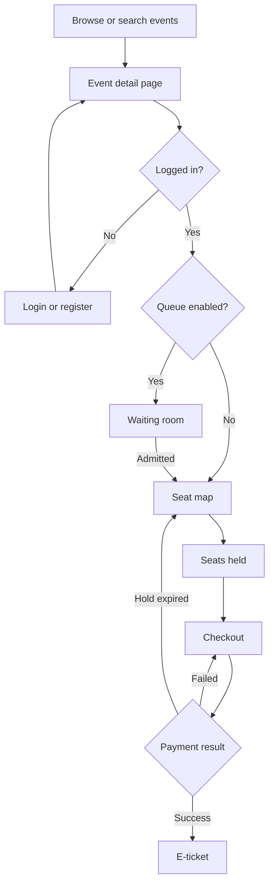
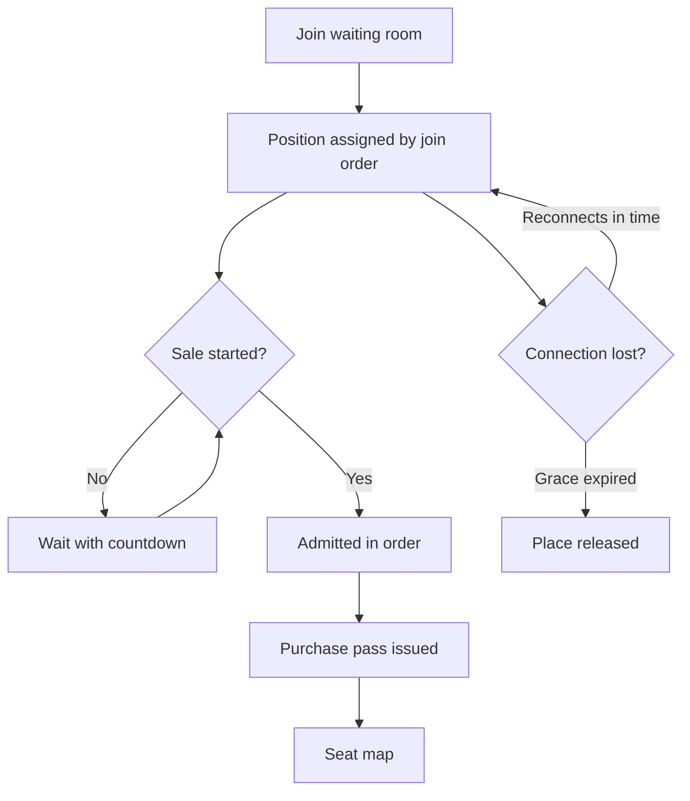
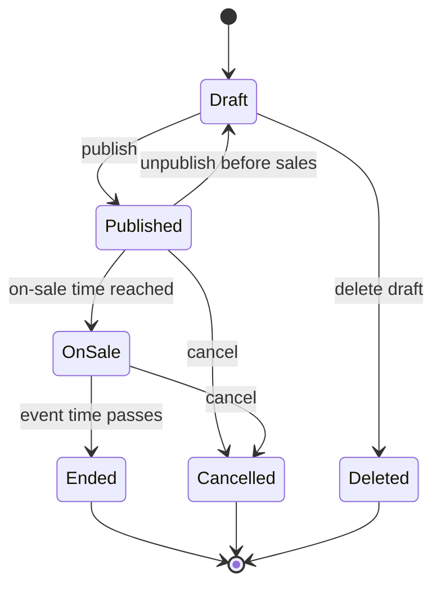
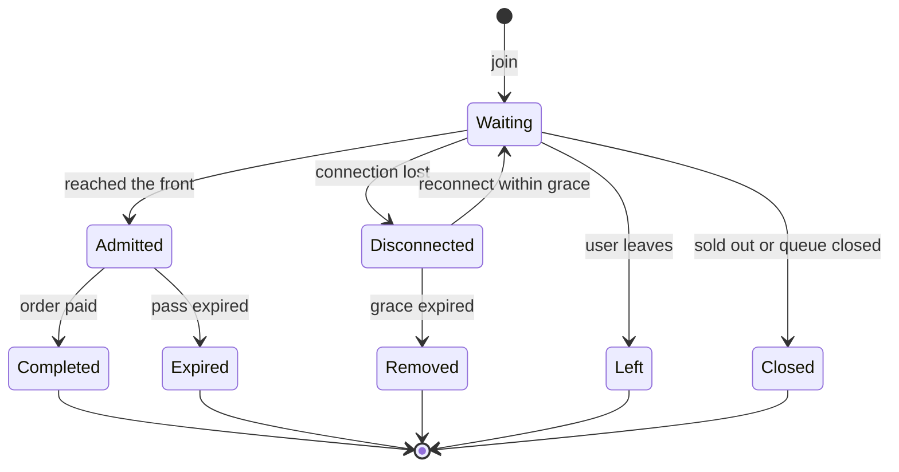
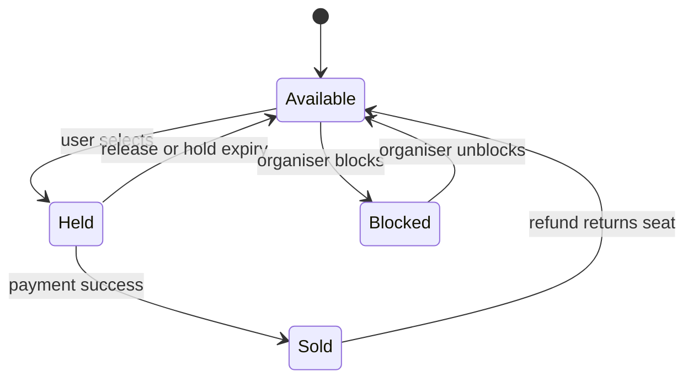
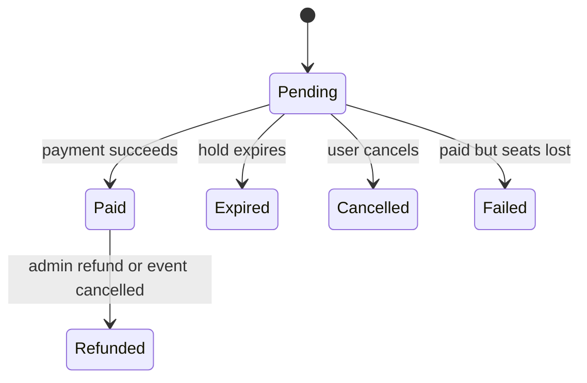

# EzTix App Flow Documentation (AFD)

_Every screen, route and user journey in EzTix, for all three roles._

| | |
|---|---|
| **Document code** | AFD |
| **Version** | 1.0 (Draft) |
| **Date** | 28 October 2026 |
| **Depends on** | PRD v1.0, TRD v1.0 |
| **Feeds into** | DBD (design brief), BSD (backend schema), IPD |

## Table of Contents

- 1. Purpose and How to Read This Document
- 2. Decisions Captured for This Document
- 3. Roles and Access Overview
- 4. Sitemap and Screen Inventory
- 5. Global Behaviour
- 6. Event-Goer Flows
- 7. Organiser Flows
- 8. Admin Flows
- 9. State Diagrams
- 10. Notifications Matrix
- 11. Error and Edge-Case Catalogue
- 12. Empty, Loading and Error States
- 13. Open Items

---

## 1. Purpose and How to Read This Document

This document describes **what the user sees and does, and what the system does in response**, one flow at a time. It does not define visual design (that is the Design Brief) or database structure (that is the Backend Schema Document).

**Conventions**

- **Flow IDs** (`F-01`, `F-02` …) and **Screen IDs** (`P` public, `B` buyer, `O` organiser, `A` admin) are referenced by later documents.
- Each flow lists: trigger, preconditions, main steps, alternative paths, and the end state.
- Requirement IDs such as `QUE-07` point to the PRD.
- Times are shown in Malaysia Time (MYT, UTC+8). Prices are shown in MYR.
- Words in `monospace` are routes or system values.

## 2. Decisions Captured for This Document

Your answers to the AFD questions, and what they change:

| # | Decision | Effect on the product |
|---|---|---|
| 1 | **Seating uses venue templates. Venues are added by admins.** | Organisers cannot create venues or draw layouts. They **pick an existing venue** and then assign ticket tiers and prices to its sections. Admins get a new **Venue management** area (screens A05 and A06). This adds a requirement (`ADM-08`, see section 13) and changes `ORG-04` |
| 2 | **Login first, then the seat map is visible** | Guests can browse and read event details, including ticket tier prices. The seat map and queue are only reachable after login |
| 3 | **Queue shows estimated wait time and position** | The waiting room displays both. The estimate is a range, recalculated as the queue moves |
| 4 | **Sold-out events get a label only** | No waitlist or "notify me" feature |
| 5 | **Admins can only view and cancel events** | Admins cannot create or edit events. They also do not get live queue controls in MVP |
| 6 | **Only admins can delete accounts** | There is no self-service delete on the profile page. The profile shows a "contact support to delete your account" note |

**Additional assumptions I made** (please confirm in section 13):

- Admin accounts are created by a seed script, not from the UI. Admins can change a user's role only between Event-goer and Organiser.
- Organiser and admin accounts cannot buy tickets. They manage the platform only. A person who wants to do both uses a separate event-goer account.
- A seat hold timer starts at the first seat selected and does **not** reset when more seats are added, which prevents hoarding.
- The purchase pass is checked when seats are held and when the order is created. It is **not** checked during payment, so a payment already in progress is not cut off when the pass expires.

## 3. Roles and Access Overview

| Capability | Guest | Event-goer | Organiser | Admin |
|---|---|---|---|---|
| Browse events, search, view event details and tier prices | Yes | Yes | Yes (read only) | Yes (read only) |
| Register and log in | Yes | n/a | n/a | n/a |
| Join the waiting room | No | Yes | No | No |
| View the seat map | No | Yes (with a valid pass if the queue is on) | No | No |
| Hold seats, check out, receive tickets | No | Yes | No | No |
| View own tickets, orders and profile | No | Yes | Own profile only | Own profile only |
| Create and edit own events | No | No | Yes | No |
| View sales and attendees for own events | No | No | Yes | All events (read only) |
| Create organiser accounts | No | No | No | Yes |
| Manage users (suspend, reactivate, role, delete) | No | No | No | Yes |
| Manage venues (templates) | No | No | No | Yes |
| View and cancel any event | No | No | Own events only | Yes |
| View all orders, simulate refunds | No | No | No | Yes |
| View audit log and settings | No | No | No | Yes |

**Redirect rules for wrong access**

- Guest opens a protected page: sent to `/login?returnTo=<page>`, and returned there after login.
- Logged-in user opens a page for another role: sees a "You don't have access to this page" screen with a link back to their home.
- Organiser or admin presses "Get tickets": sees a notice "Organiser and admin accounts cannot buy tickets. Please use an event-goer account."

## 4. Sitemap and Screen Inventory

### 4.1 Sitemap

```text
Public
├─ /                               Home                         (P01)
├─ /events                         Event list and search        (P02)
├─ /events/[slug]                  Event detail                 (P03)
├─ /login                          Login                        (P04)
├─ /register                       Register                     (P05)
├─ /verify-email                   Email verification           (P06)
├─ /forgot-password                Forgot password              (P07)
├─ /reset-password, /set-password  Reset or first-time set      (P08)
├─ /privacy, /terms                Policy pages                 (P09)
└─ error screens                   404, 403, 500, offline       (P10), waking up (P11)

Event-goer (login required)
├─ /queue/[eventId]                Waiting room                 (B01)
├─ /events/[slug]/seats            Seat map                     (B02)
├─ /checkout/[orderId]             Checkout                     (B03)
├─ /mock-gateway/[paymentId]       Mock payment gateway         (B04)
├─ /orders/[orderId]               Order result                 (B05)
├─ /account/tickets                My tickets                   (B06)
├─ /account/tickets/[ticketId]     Ticket detail                (B07)
├─ /account/orders                 Order history                (B08)
└─ /account                        Profile                      (B09)

Organiser
├─ /organiser                      Dashboard                    (O01)
├─ /organiser/events               My events                    (O02)
├─ /organiser/events/new           Create event wizard          (O03)
├─ /organiser/events/[id]/edit     Edit event wizard            (O03)
├─ /organiser/events/[id]          Event overview               (O04)
├─ /organiser/events/[id]/sales    Sales and attendees          (O05)
├─ /organiser/events/[id]/queue    Queue control                (O06)
└─ /organiser/profile              Profile and password         (O07)

Admin
├─ /admin                          Overview                     (A01)
├─ /admin/users                    Users list                   (A02)
├─ /admin/users/[id]               User detail                  (A03)
├─ /admin/organisers/new           Create organiser             (A04)
├─ /admin/venues                   Venues list                  (A05)
├─ /admin/venues/new, /[id]        Venue create or edit         (A06)
├─ /admin/events                   Events list                  (A07)
├─ /admin/events/[id]              Event detail (view, cancel)  (A08)
├─ /admin/orders                   Orders list                  (A09)
├─ /admin/orders/[id]              Order detail                 (A10)
├─ /admin/audit                    Audit log                    (A11)
└─ /admin/settings                 Platform settings            (A12)
```

### 4.2 Public and Shared Screens

| ID | Screen | Purpose and key content | Primary actions |
|---|---|---|---|
| P01 | Home | Featured events, upcoming events, category chips, search bar | Open event, search, login, register |
| P02 | Event list | Cards with poster, title, date, venue, price from, status label. Filters: category, date range, state or city, venue. Search by name. Sort by date or popularity | Filter, search, open event, paginate |
| P03 | Event detail | Poster, title, description, date and time, doors open, venue and address, ticket tiers with prices, status label, on-sale countdown, organiser name, rules (age, refund policy) | **Get Tickets** or **Join Waiting Room** (varies by status, see 6.5), share link |
| P04 | Login | Email, password, forgot link, register link | Log in |
| P05 | Register | Name, email, password, phone (optional), consent checkbox (privacy policy and terms) | Create account |
| P06 | Verify email | Landing page for the emailed link, shows success or expired link | Resend verification, go to login |
| P07 | Forgot password | Email field | Send reset link (always shows the same confirmation message) |
| P08 | Reset or set password | New password and confirm. Used by both reset and organiser invite | Save password |
| P09 | Privacy policy, Terms | Static content | None |
| P10 | Error screens | 404 not found, 403 no access, 500 error, offline notice. Each has a clear way back | Go home, retry |
| P11 | Waking up | Shown when the API takes more than a few seconds (free-hosting cold start). Friendly message and progress indicator | None, auto-continues |

**Event status labels shown on cards and P03** (all derived from event and inventory state):

| Label | When shown | Main button on P03 |
|---|---|---|
| Coming soon | Published, on-sale time in the future, waiting room not yet open | Disabled "On sale at 10:00 AM, 12 Dec", with countdown |
| Waiting room open | Queue enabled and pre-queue window is open | Join Waiting Room |
| On sale | Sale is live | Get Tickets |
| Sold out | All tickets sold | Disabled "Sold out" |
| Sales closed | The organiser's sale window ended before the event | Disabled "Sales closed" |
| Ended | Event time has passed | None |
| Cancelled | Event cancelled | None, with a cancellation notice |

### 4.3 Event-Goer Screens

| ID | Screen | Purpose and key content | Primary actions |
|---|---|---|---|
| B01 | Waiting room | Event name, **position** ("You are #1,234"), **estimated wait** ("About 6 to 9 minutes"), people ahead, connection status, sale countdown if before on-sale, rules ("Don't refresh, you won't lose your place"), a leave button | Leave queue |
| B02 | Seat map | Zoomable seat map coloured by tier, legend, tier price list, selected seats panel with total, hold countdown, pass countdown | Select or deselect seats, GA quantity picker, **Continue to checkout**, cancel selection |
| B03 | Checkout | Order summary (event, date, seats, per-ticket price, service fee, tax, total in MYR), hold countdown, payment method list (FPX, Card, Touch 'n Go eWallet, GrabPay, Boost, ShopeePay), terms checkbox | Pay, back to seats, cancel order |
| B04 | Mock gateway | Looks like an external payment page for the chosen method. A **test panel** (visible only in test mode) forces Success, Fail, Cancel, Timeout or Delayed success | Confirm or cancel payment |
| B05 | Order result | Success: confirmation, order number, tickets summary, buttons. Failure: reason and retry. Pending: "Confirming your payment" while waiting for final status | View tickets, retry payment, back to event |
| B06 | My tickets | Upcoming and past tabs. Ticket cards with event, date, seat, status (Valid, Used, Cancelled) | Open ticket |
| B07 | Ticket detail | Large QR code, ticket code, event, venue, date and time, seat or tier, order reference, status | Download PDF (P1), back |
| B08 | Order history | List of orders with status (Pending, Paid, Failed, Cancelled, Expired, Refunded), date, total | Open order |
| B09 | Profile | Name, email (read only), phone, change password, consent record, note "To delete your account, contact support" | Save changes, change password, log out |

### 4.4 Organiser Screens

| ID | Screen | Purpose and key content | Primary actions |
|---|---|---|---|
| O01 | Dashboard | Cards: active events, tickets sold (30 days), revenue (30 days), upcoming on-sale dates. Recent orders list | Open event, create event |
| O02 | My events | Table: title, date, status, tickets sold or capacity, revenue. Filter by status | Create, open, edit, duplicate (P2), delete draft |
| O03 | Create or edit event wizard | Five steps, see flow F-14 | Save draft, next, back, publish |
| O04 | Event overview | Status, key stats, shareable event link, quick links to edit, sales, queue | Edit, unpublish (before sales), cancel event |
| O05 | Sales and attendees | Tickets sold, revenue, tier breakdown, sales over time chart, attendee table (name, email, ticket, seat, status) with search | Export CSV (P1) |
| O06 | Queue control | Live queue stats (waiting, active passes, admitted, completed), current settings | Pause or resume, close queue (P1) |
| O07 | Profile | Name, company, contact email, change password | Save, change password |

### 4.5 Admin Screens

| ID | Screen | Purpose and key content | Primary actions |
|---|---|---|---|
| A01 | Overview | Totals: users, organisers, events, tickets sold, gross sales, active queues. Recent activity | Navigate |
| A02 | Users list | Table with name, email, role, status, joined date. Search, filter by role and status, pagination | Open user, create organiser |
| A03 | User detail | Profile data, role, status, order count, events (if organiser), activity | Suspend or reactivate, change role, **delete (anonymise)**, resend invite |
| A04 | Create organiser | Name, email, company, phone (optional) | Create and send invite |
| A05 | Venues list | Table: venue, city and state, template type, capacity, events using it, status | Create, open, archive |
| A06 | Venue create or edit | Name, address, state and city, template type, section and row configuration, capacity, live seat map preview | Save, archive |
| A07 | Events list | All events: title, organiser, date, status, sales | Open event |
| A08 | Event detail | Read-only event data and sales summary | **Cancel event** |
| A09 | Orders list | Search by order ID, email or event. Filter by status and date | Open order |
| A10 | Order detail | Buyer, event, seats, payment attempts, status history | **Simulate refund** |
| A11 | Audit log (**deferred, future release**) | Time, admin, action, target. Filter by action and admin | Filter |
| A12 | Settings | Service fee, tax rate, default hold duration, default pass duration, per-order seat limit default | Save |

## 5. Global Behaviour

### 5.1 Navigation Shells

| Shell | Used by | Layout |
|---|---|---|
| Public shell | Guests and event-goers | Top bar: logo, Events, search, then **Login and Register** (guest) or **My Tickets and account menu** (event-goer). Footer with policy links |
| Organiser shell | Organisers | Left sidebar: Dashboard, My Events, Profile. Top bar with user menu and log out |
| Admin shell | Admins | Left sidebar: Overview, Users, Venues, Events, Orders, Audit log, Settings. Top bar with user menu |

Mobile: sidebars collapse into a menu button. The seat map and waiting room use a full-screen focused layout with no distracting navigation.

### 5.2 Authentication and Session

- On first load, the app tries a silent token refresh. If it fails, the user is treated as a guest.
- **Session expiry during a flow:** if the refresh fails while the user is in the waiting room or on the seat map, show a login dialog on top of the current screen. After login, return to the same screen and keep the queue position and seat holds (they belong to the user account, not the browser session).
- **Suspended during a session:** the next API call fails. The user sees "Your account has been suspended" and is logged out. Queue position and holds are released.
- **Logout:** clears tokens and local state, leaves the waiting room (position is lost), and keeps seat holds until they expire.

### 5.3 Common UI Rules

- **Time:** show MYT everywhere. On event cards use "Sat, 12 Dec 2026, 8:00 PM".
- **Countdowns** (sale start, pass, hold) use the **server's** timestamps. If the client clock is off, the correction is applied silently.
- **Toasts** for quick confirmations ("Profile saved"). **Inline errors** for form fields. **Dialogs** for destructive confirmations.
- **Destructive actions** (cancel event, suspend or delete user, simulate refund) always ask for confirmation and say what will happen.
- **Forms** keep entered data after a validation error. Long forms (event wizard) autosave drafts.
- **Responsive:** every screen works on a 360 px wide phone. Tables become card lists on small screens.
- **Real-time connection indicator** in the waiting room and seat map: Connected, Reconnecting, or Using fallback updates.

### 5.4 Route Protection Summary

| Route group | Rule |
|---|---|
| Public | Open to everyone |
| `/queue/*`, `/events/*/seats`, `/checkout/*`, `/orders/*`, `/account/*` | Event-goer only |
| `/organiser/*` | Organiser only |
| `/admin/*` | Admin only |
| Seat map and hold actions on a queued event | Also require a valid purchase pass |

## 6. Event-Goer Flows

### 6.1 Overall Buyer Journey



### F-01 Register and Verify Email

- **Trigger:** Guest selects Register.
- **Preconditions:** None.
- **Steps:**
  1. Guest fills name, email, password, optional phone, and ticks the consent box.
  2. System validates (email format and uniqueness, password strength, consent ticked).
  3. System creates the account with status Unverified, stores the consent version and time, and emails a verification link (valid 24 hours).
  4. Guest sees "Check your email to verify your account".
  5. Guest opens the link (P06). System marks the email verified.
  6. Guest is taken to login, or logged in automatically if you decide to allow it (open item).
- **Alternatives:**
  - Email already registered: show a generic message ("If this email can be used, we'll send a link") to avoid revealing which emails exist.
  - Link expired or already used: P06 shows the problem and a **Resend verification** button.
  - Unverified user tries to log in: allowed to log in but cannot join queues or buy until verified. A banner offers **Resend verification**.
- **End state:** Active, verified event-goer.

### F-02 Login, Logout, Forgot and Reset Password

- **Login:**
  1. User enters email and password.
  2. System checks credentials, account status and shows the right outcome:
     - Wrong credentials: "Incorrect email or password" (never says which).
     - Suspended: "Your account has been suspended. Contact support."
     - Success: tokens issued, user is sent to `returnTo` if present, otherwise to their home (event-goer to home, organiser to `/organiser`, admin to `/admin`).
  3. After several failed attempts, a Turnstile check is shown, and further attempts are rate limited.
  4. **Must-change-password flag** (new organisers): user is forced to the set-password screen first.
- **Forgot password:** user enters email, system always shows "If an account exists, we've sent a reset link". Link is valid 1 hour and single-use. P08 sets the new password, signs out all other sessions, and sends a "your password was changed" email.
- **Logout:** from the account menu. Clears session and returns to home.

### F-03 Browse and Search Events

- **Trigger:** User opens Home or Events list.
- **Steps:**
  1. System lists published events, upcoming first, with status labels.
  2. User types in search (matches title, organiser, venue) or applies filters (category, date range, state and city, venue).
  3. List updates with the filters reflected in the URL so results can be shared.
  4. User opens an event card to reach P03.
- **Alternatives:**
  - No results: "No events match your filters" with a **Clear filters** button.
  - Ended and cancelled events are hidden by default and available through a "Past events" filter.
- **Rules:** Draft events never appear. Events are visible to everyone including guests.

### 6.5 F-04 Event Detail and the Purchase Entry Point

This is where the main button changes depending on user type and event state.

| Viewer | Event state | Button and behaviour |
|---|---|---|
| Guest | Any on-sale or waiting-room state | **Log in to get tickets** (or "Log in to join the waiting room"). Goes to login with `returnTo` set to this event, and returns here afterwards |
| Event-goer, unverified | On sale or waiting room open | Button shown but clicking it shows "Please verify your email first" with a resend option |
| Event-goer | Coming soon | Disabled button with countdown to the waiting room or sale |
| Event-goer | Waiting room open (before sale) | **Join Waiting Room** → F-05 |
| Event-goer | On sale, queue enabled | **Get Tickets** → F-05 (join the queue) |
| Event-goer | On sale, queue disabled | **Get Tickets** → F-06 (seat map directly) |
| Event-goer | Sold out | Disabled "Sold out" label, no other action |
| Event-goer | Ended or cancelled | No purchase button, notice shown |
| Organiser or admin | Any | Read-only. A notice explains that these accounts cannot buy tickets |

Ticket tier prices are visible to guests, but the **seat map is not**. Guests see only the tier list and prices.

### F-05 Join the Queue and Wait (FIFO Waiting Room)

- **Trigger:** Event-goer presses Join Waiting Room or Get Tickets on a queued event.
- **Preconditions:** Logged in, verified, not suspended, event queue is open (pre-queue window or on sale), user does not already have an active purchase pass for this event.
- **Steps:**
  1. System checks eligibility. A Turnstile challenge may appear.
  2. System assigns a **server-side sequence number**, which fixes the user's place. The user sees B01 immediately with position, estimated wait and total in queue.
  3. **Before the sale starts:** B01 shows "Sale starts at 10:00 AM" with a countdown. Position is already set by join order. Joining earlier means being further ahead. No one is admitted until the sale starts.
  4. **After the sale starts:** the system admits users in order at the configured rate. B01 updates live: position decreases, estimate refreshes.
  5. When the user reaches the front, the system issues a **purchase pass** (default 10 minutes) and shows "It's your turn!" for a moment, then redirects to the seat map (F-06). The pass countdown is shown at the top of the seat map.
- **How position and wait are displayed:**
  - Position: "You are #1,234 in line" and "1,233 people ahead of you". The number is smoothed from live progress and periodically corrected to the exact value.
  - Estimated wait: a **range** based on the recent admission rate, for example "About 6 to 9 minutes". It shows "Less than a minute" near the front and "Calculating…" for the first few seconds. A note says the estimate can change.
- **Leaving and returning:**
  - Refresh, closing the tab or a connection drop: the place is kept for a **grace period (default 2 minutes)**. Reopening the event and pressing Get Tickets or Join resumes the same place. B01 shows "Reconnecting…" meanwhile.
  - After the grace period, the place is lost. Joining again puts the user at the **back**.
  - Pressing **Leave queue** asks for confirmation ("You'll lose your place") and removes the user.
  - Opening a second tab or device: both show the same single position.
- **Alternative paths:**
  - **Queue paused by the organiser (P1):** B01 shows "The queue is paused. Your place is safe."
  - **Event sold out while waiting:** B01 changes to "Sorry, this event has sold out" with a link back to events. The place is released.
  - **Queue closed or event cancelled:** B01 shows the reason and a link back.
  - **Real-time connection fails:** B01 falls back to checking status every few seconds and shows "Using fallback updates".
  - **Already admitted (has a valid pass):** pressing Get Tickets sends the user straight back to the seat map with the remaining pass time.
- **End state:** User holds a purchase pass and is on the seat map.



### F-06 Select Seats and Hold Them

- **Trigger:** Event-goer lands on the seat map after being admitted (queued events) or after pressing Get Tickets (non-queued events).
- **Preconditions:** Logged in. For queued events, a valid pass.
- **Steps:**
  1. System loads the seat map and shows each seat's current state: Available, Selected by you, Held by someone else, Sold, Unavailable.
  2. User pans and zooms, and taps a section to zoom into it. The price legend shows each tier.
  3. **Reserved seating:** user taps seats to select them. The side panel lists the seats and running total.
  4. **General admission:** user picks a quantity per tier.
  5. On the first selection the system **holds** the seats and starts the **hold countdown** (default 8 minutes). Adding more seats does not reset the timer.
  6. Live updates change other users' seats on the map as they are held, released or sold.
  7. User presses **Continue to checkout**. System creates a pending order (F-07).
- **Rules:**
  - Maximum seats per order (default 6). At the limit, extra seats cannot be selected and a message explains why.
  - A user can deselect a seat at any time, which releases it immediately.
  - If the user's hold or pass expires, see alternatives.
- **Alternative paths:**
  - **Seat taken first:** user taps a seat that was just taken. A message says "That seat was just taken. Please choose another." The map refreshes.
  - **Part of the selection is lost** (for example, a hold failed for one seat out of three): none of the seats are held (all or nothing). The user is told which seat caused the problem.
  - **Hold expires:** a warning appears at 1 minute left. At zero, seats are released, the selection is cleared and the user sees "Your hold expired". If the pass is still valid, the user can select again. If not, see next.
  - **Pass expires:** the user sees "Your time in the purchase window has ended". Any unpaid holds are released. The user is offered **Rejoin the queue** (goes to the back). If a payment is already in progress it is allowed to finish.
  - **Event sells out while selecting:** user sees "This event has just sold out".
  - **Real-time unavailable:** the map refreshes by itself every few seconds and the indicator says "Using fallback updates".
  - **User navigates away or closes the tab:** holds remain until the timer ends, then release automatically.
- **End state:** User has held seats and a pending order, and is on checkout.

### F-07 Checkout and Mock Payment

- **Trigger:** User presses Continue to checkout.
- **Steps:**
  1. System creates a **pending order** with a price snapshot. B03 shows the summary, fee, tax and total (calculated by the server) with the hold countdown running.
  2. User picks a payment method and ticks the terms box.
  3. User presses **Pay**. The button disables to prevent double clicks.
  4. System redirects to the mock gateway (B04) for that method:
     - **FPX:** choose a bank, then a mock bank login and confirm page.
     - **Card:** fake card form with test card numbers shown as hints.
     - **Touch 'n Go, GrabPay, Boost, ShopeePay:** mock wallet screen with a confirm button.
  5. User confirms (or the tester forces an outcome in the test panel).
  6. Gateway notifies the system. System finalises the order.
  7. User lands on B05 which shows the result.
- **Outcomes:**

| Outcome | System action | What the user sees |
|---|---|---|
| Success | Order Paid, seats Sold, tickets issued, pass released, confirmation email sent | B05 success with order number and **View tickets** |
| Failed | Payment marked Failed, order stays Pending while the hold lasts | B05 failure message with **Try again** (back to B03) |
| Cancelled by user | Same as failed | "Payment cancelled" with **Try again** or **Back to seats** |
| Timeout | Same as failed | "The payment timed out" with **Try again** |
| Delayed success | Order shows Pending, final status arrives later | B05 shows "Confirming your payment…" and updates automatically |
| Hold expired before payment | Order Expired, seats released | "Your seats were released" with **Choose seats again** |
| Paid but seats already lost (rare) | Order set to Failed, simulated refund | "We couldn't complete your order. You haven't been charged" |

- **Other rules:**
  - Pressing Pay twice or refreshing never creates two orders or two sets of tickets.
  - **Cancel order** on B03 releases the seats and marks the order Cancelled.
  - The **test panel** only appears when the environment is in test mode, and is clearly labelled.
  - **Pressing Pay lifts the hold once** to at least 10 minutes from that moment (never more than 20 minutes after the hold began), so a buyer at the payment page is not cut off. B03 shows the new time.
- **End state:** Paid order with tickets, or a clear route to retry or reselect.

### F-08 View Tickets and Orders

- **Trigger:** User opens My Tickets or follows the email link.
- **Steps:**
  1. B06 lists tickets, upcoming first. Tabs for Upcoming and Past.
  2. User opens a ticket (B07) to see the QR code and details.
  3. User can open Order history (B08) and order details.
- **Rules:**
  - Ticket status shows Valid, Used (after check-in) or Cancelled (after refund or event cancellation).
  - Cancelled events show a notice on the ticket explaining the refund status.
- **Alternatives:** No tickets yet shows an empty state with **Browse events**.

### F-09 Profile and Account

- **Edit profile:** user changes name or phone and saves. Email is read-only in MVP.
- **Change password:** current password, new password, confirm. Other sessions are signed out.
- **Delete account:** not available to users. The profile says "To delete your account, contact support" with a support email link. Deletion is done by an admin (F-19).

## 7. Organiser Flows

### F-10 Organiser Onboarding (Invite and First Login)

- **Trigger:** Admin creates an organiser (F-17).
- **Steps:**
  1. Organiser receives an invite email with a set-password link (valid 72 hours, single use).
  2. Organiser opens the link (P08) and sets a password.
  3. System activates the account and logs them in to the Organiser dashboard (O01) with a short welcome panel.
- **Alternatives:**
  - Link expired: P08 shows "This invite has expired. Ask the platform admin to resend it."
  - Organiser forgets the password later: uses the normal forgot password flow (F-02).

### F-11 Dashboard and Event List

- Organiser lands on O01 with headline numbers and recent orders.
- O02 lists their events with status filters. Organisers see **only their own events**.
- Empty state: "You haven't created any events yet" with **Create your first event**.

### F-14 Create or Edit an Event (Wizard)

The wizard has five steps. Progress is shown at the top. **Save draft** is available on every step and the wizard autosaves. Required fields are validated per step before moving on.

| Step | Content | Key rules |
|---|---|---|
| 1. Basics | Title, category, description, poster image upload, age or entry rules, refund policy text | Poster type and size limits. Title and description required |
| 2. Date and venue | Event date, start time, doors-open time, end time, **venue picked from the admin-managed list** (search by name, state or city) | Venue must be active. A **seat map preview** of the chosen venue is shown. Event date must be in the future |
| 3. Tickets and seating | Define tiers (name, price in MYR, colour). **Assign each venue section to a tier** (reserved sections). For standing or GA sections, set quantity per tier. Optional: **block seats** (for example, sound desk) so they are never sold. Per-order limit | Every sellable section must belong to a tier. Price must be zero or more. Total capacity is shown and updates live |
| 4. Sale and queue | On-sale date and time, optional sale end, **queue on or off**. If on: waiting-room opening time (default 30 minutes before sale), admission rate, maximum users in purchase stage, pass duration, hold duration | Waiting room must open before the sale. Defaults come from admin Settings |
| 5. Review and publish | Read-only summary of everything, validation checklist, preview of the public event page | **Publish** is enabled only when every check passes |

- **Publish:** event moves from Draft to **Published** and appears publicly with the label Coming soon. On the on-sale time it becomes On sale automatically.
- **Edit rules after publishing:**
  - Before sales begin: all fields can be edited. The organiser can also **Unpublish** to move the event back to Draft.
  - After sales begin: only description, poster, rules text and queue settings that are not yet in use can change. **Date, venue, tier prices and section assignments are locked.** Sold seats can never be changed. To change locked items the organiser must cancel the event.
- **Delete:** drafts can be deleted. Published events cannot be deleted, only cancelled.
- **Alternatives:**
  - Closing the browser mid-wizard: the draft is restored next time.
  - Venue later archived by admin: the event keeps working, the venue just cannot be selected for new events.
  - Validation failure at publish: the checklist highlights the failing step and field.

### F-12 Monitor Sales and Attendees

- **Trigger:** Organiser opens an event, then Sales.
- **Content:** tickets sold, revenue, tier breakdown, sales over time, attendee list with search.
- **Rules:** revenue shown is gross (no payout or fee calculation in MVP). Attendee personal data (name, email) is visible only for the organiser's own events.
- **P1:** Export attendee list to CSV.

### F-13 Queue Control (P1)

- **Trigger:** Organiser opens an event, then Queue, while the queue is active.
- **Content:** live counts of waiting, active passes, admitted and completed.
- **Actions:**
  - **Pause:** stops new admissions. Waiting users keep their places and see "The queue is paused".
  - **Resume:** admissions continue.
  - **Close queue:** ends the queue. Waiting users see a closed message. Users who already hold a pass can finish.
- Each action asks for confirmation and is recorded in the audit log.
- Admission rate and limits can only be changed **before** the queue opens (to keep fairness during a live sale).

### F-15 Cancel an Event (Organiser)

- **Trigger:** Organiser selects Cancel event on O04.
- **Steps:**
  1. System shows the impact: number of paid orders and total to refund.
  2. Organiser types the event title to confirm and optionally adds a message to ticket holders.
  3. System sets the event to **Cancelled**, closes any queue, releases all holds, cancels all tickets, marks paid orders **Refunded (simulated)** and sends a cancellation email to every buyer.
  4. Event page shows the Cancelled label and notice.
- **Note:** in MVP the refund is simulated, so no money moves.

## 8. Admin Flows

### F-16 Admin Overview

- A01 shows platform totals and recent activity. Clicking a card opens the matching list.

### F-17 Create an Organiser Account

- **Trigger:** Admin opens Users and selects Create organiser (A04).
- **Steps:**
  1. Admin enters organiser name, email, company and optional phone.
  2. System checks the email is not already in use.
  3. System creates the account with role Organiser and status Invited, generates a single-use invite token and emails the set-password link (F-10).
  4. Admin sees a confirmation and the new user appears in the list with status **Invited**.
  5. Audit log records the action.
- **Alternatives:**
  - Email exists: error "A user with this email already exists" with a link to that user.
  - Invite not used: admin can **Resend invite** from the user detail page (old link is invalidated).

### F-18 Manage Users

- **Trigger:** Admin opens Users (A02).
- **Steps:**
  1. Admin searches by name or email and filters by role and status.
  2. Admin opens a user (A03).
  3. Available actions:
     - **Suspend:** user cannot log in or buy. Active sessions end. Their queue place and holds are released. Event-goer's existing tickets remain valid. An organiser's events stay visible but cannot be edited, and the admin is warned before confirming.
     - **Reactivate:** restores access.
     - **Change role:** between Event-goer and Organiser only. Not allowed on the admin's own account. The admin is warned about consequences.
     - **Resend invite** for Invited accounts.
  4. Each action requires confirmation, and is written to the audit log.

### F-19 Delete a User (Admin Only)

- **Trigger:** Admin selects Delete on A03 (for example, after a support request).
- **Preconditions and checks:**
  - **Event-goer** with active holds or unpaid orders: holds are released first. With upcoming paid tickets: deletion is blocked until those orders are cancelled or refunded.
  - **Organiser** with events that are not Ended or Cancelled: deletion is blocked. The admin is told to cancel those events or suspend the account instead.
- **Steps:**
  1. System shows what will happen: personal data is **anonymised** (name, email, phone, consent records removed) and order records are kept without personal identifiers for accounting.
  2. Admin types the user's email to confirm.
  3. System anonymises the account, ends all sessions and writes the audit log.
  4. Deleted user disappears from normal lists and cannot log in. The email address becomes free to register again.
- **Rule:** admins cannot delete their own account.

### F-20 Manage Venues (Templates)

- **Trigger:** Admin opens Venues (A05).
- **Create:**
  1. Admin presses **Create venue** and enters name, address, state and city.
  2. Admin chooses a **template type**, for example:
     - **Theatre or hall (reserved rows):** sections with rows and seats per row.
     - **Standing or GA:** capacity only.
     - **Mixed:** reserved sections plus a standing area.
  3. Admin configures the template: number of sections, section names, rows per section, seats per row, seat numbering style, optional aisle gaps.
  4. A **live seat map preview** updates as the configuration changes.
  5. Admin saves. The venue becomes **Active** and is selectable by organisers.
- **Edit:** venue details and layout can always change, and the new values **override** the old ones (there is no versioning in MVP). Events that are already published keep their own copy of the layout, so an edit only affects events published afterwards. The editor shows a note: "Changes apply to new events only." Section keys stay fixed when a section is renamed.
- **Archive:** hides the venue from new events but keeps existing events working. A venue with no events can be deleted.
- **Rules:** layout limits (for example, a maximum number of seats per venue) protect seat map performance. Seat count is shown prominently.

### F-21 View and Cancel Events (Admin)

- **Trigger:** Admin opens Events (A07), then an event (A08).
- **View:** read-only event details, organiser, venue, queue status and sales summary.
- **Cancel:**
  1. Admin presses **Cancel event**. System shows the impact (paid orders and total).
  2. Admin must enter a reason (shown to the organiser and kept in the audit log) and type the event title to confirm.
  3. The system carries out the same steps as F-15 and also emails the organiser.
- **Not available to admins in MVP:** create or edit events, change queue settings, pause or close live queues.

### F-22 View Orders and Simulate Refunds

- **Trigger:** Admin opens Orders (A09).
- **Steps:**
  1. Admin searches by order ID, buyer email or event and filters by status and date.
  2. Admin opens an order (A10) to see buyer, event, seats, payment attempts and status history.
  3. For a Paid order, admin can press **Simulate refund**, enter a reason, and confirm.
  4. System sets the order to **Refunded**, cancels its tickets, returns the seats to inventory only if the event is still on sale and the setting allows it, and emails the buyer.
  5. Audit log records the action.
- **Rule:** a Used ticket cannot be refunded without the admin explicitly confirming this.

### F-23 Audit Log and Settings

- **Audit log (A11, deferred to a future release):** would show who did what and when for: organiser creation, suspend and reactivate, role change, deletion, event cancellation, refunds, venue changes, settings changes. It is read-only and cannot be edited or deleted.
- **Settings (A12, P1):** service fee, tax rate, default hold and pass durations, default per-order seat limit, default waiting-room lead time. Changes apply to **new** events and orders only and are logged.

## 9. State Diagrams

### 9.1 Event Lifecycle



"Sold out" is not a separate state. It is a label shown while the event is On sale and no tickets remain.

### 9.2 Queue Entry



### 9.3 Seat



### 9.4 Order



### 9.5 User Account

| State | How it is entered | Can log in | Can buy or manage |
|---|---|---|---|
| Unverified | Event-goer registers | Yes | Browse only. Cannot queue or buy |
| Active | Email verified, or organiser sets password | Yes | Per role |
| Invited | Admin creates organiser | No (must set password) | No |
| Suspended | Admin suspends | No | No |
| Deleted (anonymised) | Admin deletes | No | No |

## 10. Notifications Matrix

| Trigger | Email | In-app | Recipient |
|---|---|---|---|
| Registration | Verification link | Banner until verified | Event-goer |
| Password reset request | Reset link | Confirmation text | User |
| Password changed | "Your password was changed" | Toast | User |
| Organiser created | Invite and set-password link | None | Organiser |
| Joined queue | None | Waiting room status | Event-goer |
| Queue progress | None | Live position and wait | Event-goer |
| Admitted | None | "It's your turn" and redirect | Event-goer |
| Hold expiring (1 minute left) | None | Warning banner | Event-goer |
| Hold or pass expired | None | Dialog | Event-goer |
| Order paid | Confirmation with tickets link | Result screen | Event-goer |
| Payment failed | None | Result screen | Event-goer |
| Event cancelled | Cancellation and refund notice | Notice on ticket and event | Ticket holders, organiser |
| Refund processed | Refund confirmation | Order status update | Buyer |
| Account suspended | Notice email | Message on next action | User |
| Event reminder (P2) | Reminder 24 hours before | None | Ticket holders |

## 11. Error and Edge-Case Catalogue

| Situation | What the user sees | Where they go |
|---|---|---|
| API is waking up (slow first response) | "Waking up the server, this can take up to a minute" (P11) | Continues automatically |
| Network lost mid-flow | "You're offline. Reconnecting…" banner. Queue and holds keep their grace periods | Resumes automatically |
| Access token expired | Silent refresh. If refresh fails, login dialog | Returns to the same screen |
| User opens a page without permission | 403 screen | Back to their home |
| Event not found or unpublished | 404 screen | Events list |
| Join queue when the queue is closed | "The waiting room isn't open" | Event page |
| Join queue while suspended | "Your account has been suspended" | Logged out |
| Try to join with an unverified email | "Verify your email first" and resend option | Stays on event page |
| Two devices in the queue at once | Both show the same position | n/a |
| Too many requests (rate limit) | "You're going a bit fast. Please wait a moment" | Retry shown |
| Seat already taken | "That seat was just taken" | Stays on map, map refreshes |
| Over the per-order seat limit | "You can select up to 6 seats per order" | Stays on map |
| Payment page closed without finishing | On return, B03 shows the pending order and remaining hold time | Retry payment |
| Same payment confirmed twice | No change, still one order | n/a |
| Pass expires during payment | Payment is allowed to finish | Normal result |
| Organiser edits a locked field after sales begin | "This can't be changed after tickets go on sale" | Stays in the wizard |
| Admin tries to delete an organiser with live events | Blocked with an explanation | User detail |
| Admin edits a venue that is used by published events | Saved. A note says the change applies to new events only | Venue page |
| Event cancelled while a user is in the queue or on checkout | "This event has been cancelled" and holds released | Events list |
| Server error (500) | Friendly error with a request reference code | Retry or home |
| Real-time connection fails | Indicator changes to "Using fallback updates" | Works with slower updates |

## 12. Empty, Loading and Error States

| Screen | Empty state | Loading state | Error state |
|---|---|---|---|
| Event list | "No events match your filters" and Clear filters | Card skeletons | "Couldn't load events" and Retry |
| Seat map | "No seats are available for this event right now" | Map skeleton with progress | Retry and fallback notice |
| My tickets | "You don't have any tickets yet" and Browse events | List skeletons | Retry |
| Order history | "No orders yet" | Skeletons | Retry |
| Organiser events | "Create your first event" | Table skeletons | Retry |
| Attendee list | "No tickets sold yet" | Skeletons | Retry |
| Admin tables | "Nothing to show" with the active filters named | Skeletons | Retry |
| Waiting room | n/a | "Joining the queue…" | "Couldn't join. Try again" with a button |

## 13. Open Items

**Changes to earlier documents caused by your answers** (applied to the PRD and TRD together with this document):

- **New requirement `ADM-08`:** admins create, edit, archive and preview venues from templates.
- **`ORG-04` changed:** organisers pick an admin-created venue and assign tiers and prices to sections. They do not build layouts.
- **Account deletion:** admin only (`AUTH` section and PDPA flow updated).
- **Admin events:** view and cancel only. The admin queue override and unpublish power are removed for MVP.
- **Guests:** can browse and see prices but not the seat map.

**Please confirm or correct:**

1. Admin accounts are created by a seed script. Role changes are limited to Event-goer and Organiser.
2. Organiser and admin accounts cannot buy tickets.
3. Hold timer starts at first selection and does not reset when more seats are added.
4. Payment is allowed to finish even if the purchase pass expires during payment. (The TRD currently says every seat, hold and order endpoint needs a pass. Payment is not on that list, but I will state it explicitly in the BSD.)
5. After email verification, should the user be logged in automatically, or sent to the login page? (I assumed login page.)
6. Should unverified users be allowed to buy tickets? (I assumed no.)
7. Venue template types for MVP: reserved rows, standing, and mixed. Do you want more, such as a stadium or curved arena layout? Curved layouts are noticeably harder to build.
8. Is an event-goer allowed to hold seats for more than one event at the same time? (I assumed yes, with a limit of one active hold group per event.)
