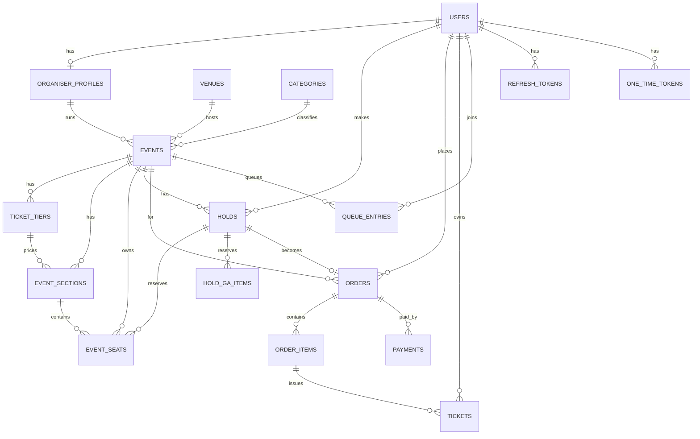

# EzTix Backend Schema Documentation (BSD)

_The database, Redis keys, core transactions, API contract and real-time events behind EzTix._

| | |
|---|---|
| **Document code** | BSD |
| **Version** | 1.0 (Draft) |
| **Date** | 28 October 2026 |
| **Depends on** | PRD, TRD, AFD, DBD (all v1.0) |
| **Feeds into** | IPD |

## Table of Contents

- 1. Purpose and Verification Status
- 2. Decisions Captured for This Document
- 3. Conventions
- 4. Data Model Overview
- 5. Prisma Schema
- 6. Raw SQL Migration (Constraints and Partial Indexes)
- 7. Redis Schema
- 8. Derived State Rules
- 9. Core Transactions
- 10. REST API Contract
- 11. Error Codes
- 12. Socket.IO Contract
- 13. Validation Rules and Limits
- 14. Seed Data
- 15. Soft Delete, Retention and PDPA Mapping
- 16. Deferred to Future Implementation
- 17. Changes to Earlier Documents and Open Items

---

## 1. Purpose and Verification Status

This document is the single reference for **how data is stored and moved** in EzTix. A developer should be able to create the database, write every query and build every endpoint from it without guessing.

**What I verified, and what I did not** (so you know how far to trust each part):

| Part | Status |
|---|---|
| Prisma schema (section 5) | **Validated** with Prisma's standalone schema parser (the build npm served was an 8.x one, and the schema uses the Prisma 7 style with no `url` in the datasource, which is also accepted there). It was not applied to a real database, so run `prisma validate` and the first migration with your pinned 7.x version |
| Raw SQL migration and the hold, release, sweeper, GA, publish-expansion, idempotency and finalise statements (sections 6 and 9) | **Executed and checked** against an in-process PostgreSQL (PGlite), 18 checks, all passed. This ran in one session, so it proves the SQL is valid and the rules work, but it does **not** prove behaviour under two simultaneous transactions. That needs the concurrency tests in the TRD (section 15) |
| Redis Lua admission script (section 7.3) | **Not executed** (no Redis server was available). Treat it as a reviewed draft and test it first against local Redis |
| REST and Socket.IO contracts | Design only, to be proven by the IPD build steps |

**Tooling note:** the latest stable Prisma I found on npm is **7.10.1** (released 15 October 2026). Version 8 exists only as release candidates and dev builds. Pin to 7.x. In Prisma 7 the database URL is set in `prisma.config.ts` and the client connects through a driver adapter (section 5.2). This corrects the "separate direct URL" wording in the TRD (patched together with this document).

## 2. Decisions Captured for This Document

| # | Your decision | How it is applied |
|---|---|---|
| 1 | **UUID v7 for IDs** | Every primary key is `uuid(7)` (time-ordered, index-friendly). Prisma generates it for normal inserts. Bulk raw inserts generate IDs in the app with the `uuidv7` npm package |
| 2 | **Soft delete only for now** | `deleted_at` on `users`, `venues` and `events`. Nothing business-related is ever hard deleted (see 3.6 for the few derived-data exceptions) |
| 3 | **Seat generation: whatever is simplest** | **Venues store a small template config (JSON), not individual seats.** When an event is **published**, its seats are generated in one bulk insert into `event_seats`. After that the event owns its own copy, so later venue edits cannot affect it. There is no separate `venue_seats` table |
| 4 | **No audit log yet** | No `audit_logs` table. Deferred (section 16). Key actions are still written to the application log |
| 5 | **Money: you decide** | Integer **sen** everywhere. Service fee and tax are stored on every order as **a snapshot** (amounts and the rates used). Rates are in **basis points** (100 bps = 1%) |
| 6 | **No venue versioning. Edits override old details** | Admin edits to a venue overwrite it in place. Because published events keep their own seat copy and layout snapshot, edits only affect events published afterwards. This **replaces** the earlier "layout locked once used" rule (patched in the PRD and AFD) |

**Extra decisions I made for you** (listed in section 17 for confirmation):

- **Event phase is derived from timestamps**, not stored. Only `DRAFT`, `PUBLISHED` and `CANCELLED` are stored. This matters because the free Render service sleeps and cannot be relied on to run a "start the sale" job.
- **Paying extends the hold once.** Pressing Pay lifts the hold to at least 10 minutes from now (capped at 20 minutes after the hold began), so a buyer at the payment page is not cut off by the 8-minute timer.
- **One active hold per user per event**, enforced by the database.
- **The realtime seat version is an in-memory counter, not a database column**, to avoid every hold fighting over one hot row.

## 3. Conventions

### 3.1 Naming

| Thing | Rule | Example |
|---|---|---|
| Tables | `snake_case`, plural | `event_seats` |
| Columns | `snake_case` | `hold_expires_at` |
| Prisma models and fields | `PascalCase` and `camelCase`, mapped with `@@map` and `@map` | `EventSeat.holdExpiresAt` |
| Enums | `SCREAMING_SNAKE` values, `PascalCase` type names | `OrderStatus.FAILED_SEATS_LOST` |
| Indexes | `<table>_<columns>_idx` (Prisma default) | |
| Raw SQL indexes and checks | Descriptive names | `holds_one_active_per_user_event` |

### 3.2 IDs

- `uuid(7)` primary keys, stored as the native Postgres `uuid` type.
- Public event URLs use `events.slug` (title slug plus a short random suffix, for example `malam-muzik-merdeka-k3x9`).
- **Order numbers** are human-readable: `EZ-` plus 8 characters from an alphabet without look-alikes (no `0 O 1 I L`), unique.
- **Ticket codes** are 12 random characters from the same alphabet, unique, and are not the ticket ID. The QR carries a signed token (TRD 10.4), not the raw code.
- **Seat index (`idx`)**: a compact integer from `0` to `N-1` per event. It is what realtime messages and hold requests use, instead of UUIDs, to keep payloads small.

### 3.3 Time

- All timestamps are `timestamptz(3)` and stored in **UTC**. Display in MYT (`Asia/Kuala_Lumpur`) only in the UI and emails.
- `created_at` defaults to `now()`. `updated_at` is maintained by Prisma (`@updatedAt`).

### 3.4 Money

- **Integer sen** (`Int`): RM 288.00 is `28800`. No floats, no decimals.
- `Int` holds up to about RM 21 million, which is plenty for one order or one price. Sums across many orders are computed in SQL and read as `BigInt`.
- **Rounding:** half up, at each step, on integers: `fee = floor((subtotal × feeBps + 5000) / 10000)`, then `tax = floor(((subtotal + fee) × taxBps + 5000) / 10000)`, then `total = subtotal + fee + tax`. Example: subtotal 57,600 sen, 6% fee gives 3,456, 8% tax on 61,056 gives 4,884, total 65,940 sen.
- Currency is always `MYR` (stored on orders for future-proofing).

### 3.5 Text and Normalisation

- Emails are stored **lower-case and trimmed** (also enforced by a CHECK). Compare only in lower-case.
- Names and titles are trimmed. Unicode is allowed (Chinese, Tamil and Jawi titles must work).
- Passwords are never stored. Only `argon2id` hashes.

### 3.6 Soft Delete Rules

| Table | Soft delete | Notes |
|---|---|---|
| `users` | `deleted_at` | Deleting also **anonymises** (section 9.10). The unique email is freed because it is replaced |
| `venues` | `deleted_at` | Only when no events use it. Otherwise archive (`status = ARCHIVED`) |
| `events` | `deleted_at` | Only for events in `DRAFT`. Published events are cancelled, not deleted |
| Everything else | None | Orders, tickets, payments, holds and queue entries are never deleted |

**Hard deletes allowed (derived or throwaway data only):**

- `event_seats` and `event_sections` rows when a never-sold event is **unpublished** (they are regenerated on the next publish).
- `refresh_tokens` and `one_time_tokens` after expiry (cleanup job).
- `hold_ga_items` cascade with their hold if a hold is ever removed (holds themselves are only status-changed).

**Making soft delete automatic:** add one Prisma client extension (`$extends`) that adds `deletedAt: null` to every `findMany`, `findFirst`, `findUnique` (as `findFirst`), `count` and `aggregate` on `User`, `Venue` and `Event`, with an explicit `includeDeleted: true` escape hatch for admin screens. This keeps `deleted_at IS NULL` out of hundreds of queries and prevents "forgot the filter" leaks.

## 4. Data Model Overview

### 4.1 Entity Relationship Diagram



### 4.2 Table Inventory

| Table | Purpose | Written by | Rows (demo scale) |
|---|---|---|---|
| `users` | All accounts and their role and status | auth, admin | Hundreds |
| `organiser_profiles` | Company details for organiser users (1:1 with a user) | admin | Few |
| `refresh_tokens` | Rotating refresh tokens (hashed) | auth | Hundreds |
| `one_time_tokens` | Email verify, password reset and invite tokens (hashed) | auth, admin | Hundreds |
| `platform_settings` | Single row of admin-controlled defaults and rates | admin | 1 |
| `categories` | Event categories (seeded) | seed | About 8 |
| `venues` | Venue details and the **layout template config** | admin | Few |
| `events` | Event details, schedule, queue settings, layout snapshot | organiser | Tens |
| `ticket_tiers` | Up to 5 price tiers per event | organiser | Up to 5 per event |
| `event_sections` | Per-event copy of each venue section, its tier and GA counters | organiser, system | Few per event |
| `event_seats` | One row per reserved seat per event, with live status | system | Up to a few thousand per event |
| `holds` | A buyer's temporary reservation (one active per user per event) | system | Hundreds |
| `hold_ga_items` | Standing quantities inside a hold | system | Hundreds |
| `queue_entries` | Durable record of the Redis queue (write-behind) | system | Up to thousands per event |
| `orders` | A purchase, with price and fee snapshot | system | Hundreds |
| `order_items` | Seats or GA units inside an order | system | Hundreds |
| `payments` | Payment attempts (mock) | system | Hundreds |
| `tickets` | Issued tickets, one per seat or GA unit | system | Hundreds |

### 4.3 The Venue Layout Template (`venues.layout_config`)

Venues hold **parameters**, not seats. A pure function in `packages/shared` expands them into seat coordinates. **The same function is used by three things:** the admin venue editor preview, the organiser wizard preview, and the publish step on the server. That guarantees the preview equals what is sold.

```json
{
  "schemaVersion": 1,
  "canvas": { "width": 1200, "height": 800 },
  "stage": { "x": 300, "y": 40, "width": 600, "height": 70, "label": "STAGE" },
  "sections": [
    {
      "key": "stalls-left",
      "name": "Stalls Left",
      "type": "RESERVED",
      "origin": { "x": 120, "y": 180 },
      "rows": {
        "count": 10,
        "firstLabel": "A",
        "labelStyle": "ALPHA",
        "seatsPerRow": 12,
        "seatNumberStart": 1,
        "numbering": "LEFT_TO_RIGHT"
      },
      "spacing": { "seat": 20, "row": 24 },
      "curvature": 0,
      "aisles": [ { "afterSeat": 6, "gap": 16 } ],
      "rowOverrides": [ { "label": "A", "seatsPerRow": 10, "offsetX": 20 } ]
    },
    {
      "key": "standing",
      "name": "Standing Zone",
      "type": "GA",
      "area": { "x": 300, "y": 520, "width": 600, "height": 200 },
      "capacity": 500
    }
  ],
  "decor": [ { "type": "LABEL", "text": "EXIT", "x": 40, "y": 760 } ]
}
```

**Rules**

- `sections[].key` is **stable and unique** within the venue. The editor generates it once (a slug of the name at creation) and never changes it on rename. Events refer to sections by this key.
- `type` is `RESERVED` (seats generated from `rows`) or `GA` (capacity only).
- `labelStyle`: `ALPHA` (A to Z, then AA, AB…) or `NUMERIC`. `numbering`: `LEFT_TO_RIGHT` or `RIGHT_TO_LEFT`.
- `curvature` (degrees, 0 to 20) arcs the rows gently. `0` means straight. This is the P1 curved-rows option from the DBD. The generator must accept it from day one, even if the editor UI comes later.
- **Seat index assignment:** `idx` counts up in order of section (array order), then row, then seat. It is only assigned at publish time and never recalculated afterwards.
- **Limits (validated on save):** at most **5,000 reserved seats** and **20,000 GA capacity** per venue, at most 30 sections.
- `venues.total_seats` and `total_ga_capacity` are recomputed on every save for list screens.

**Function contract (in `packages/shared`)**

```ts
type GeneratedSeat = { sectionKey: string; rowLabel: string; seatNumber: number; x: number; y: number };
type GeneratedLayout = {
  canvas: { width: number; height: number };
  shapes: unknown[];        // stage, section outlines, GA areas, decor (for drawing)
  seats: GeneratedSeat[];   // reserved seats only, in idx order
  gaZones: { key: string; name: string; capacity: number }[];
};
function generateLayout(config: LayoutConfig): GeneratedLayout; // pure and deterministic
```

### 4.4 What Gets Copied When an Event Is Published

| Source | Copied to | Why |
|---|---|---|
| `venues.layout_config` (full JSON) | `events.layout_snapshot` | The map keeps drawing correctly even if the venue is later edited, archived or deleted |
| Generated seats | `event_seats` (bulk insert) | Live status per seat, independent of the venue |
| Section list | `event_sections` | Tier assignment and GA counters per event |

Before publishing (draft), the event only has `venue_id`, the `event_sections` rows the organiser has assigned to tiers, and the `blocked_seats` JSON list.

## 5. Prisma Schema

### 5.1 `prisma/schema.prisma`

This is the validated schema, formatted by Prisma. In Prisma 7 the `datasource` block has **no `url`** (it lives in `prisma.config.ts`).

```prisma
// EzTix: prisma/schema.prisma
// Prisma 7 style: the database URL lives in prisma.config.ts, not here.

generator client {
  provider = "prisma-client"
  output   = "../src/generated/prisma"
}

datasource db {
  provider = "postgresql"
}

// ───────────── Enums ─────────────

enum UserRole {
  EVENT_GOER
  ORGANISER
  ADMIN
}

enum UserStatus {
  UNVERIFIED
  ACTIVE
  INVITED
  SUSPENDED
}

enum OneTimeTokenType {
  EMAIL_VERIFY
  PASSWORD_RESET
  INVITE
}

enum MalaysianState {
  JOHOR
  KEDAH
  KELANTAN
  MELAKA
  NEGERI_SEMBILAN
  PAHANG
  PERAK
  PERLIS
  PULAU_PINANG
  SABAH
  SARAWAK
  SELANGOR
  TERENGGANU
  KUALA_LUMPUR
  LABUAN
  PUTRAJAYA
}

enum VenueStatus {
  ACTIVE
  ARCHIVED
}

enum EventStatus {
  DRAFT
  PUBLISHED
  CANCELLED
}

enum SectionType {
  RESERVED
  GA
}

enum SeatStatus {
  AVAILABLE
  HELD
  SOLD
  BLOCKED
}

enum HoldStatus {
  ACTIVE
  CONVERTED
  RELEASED
  EXPIRED
}

enum QueueEntryStatus {
  WAITING
  ADMITTED
  COMPLETED
  EXPIRED
  REMOVED
  LEFT
  CLOSED
}

enum OrderStatus {
  PENDING
  PAID
  CANCELLED
  EXPIRED
  FAILED_SEATS_LOST
  REFUNDED
}

enum OrderItemKind {
  SEAT
  GA
}

enum PaymentMethod {
  FPX
  CARD
  TNG_EWALLET
  GRABPAY
  BOOST
  SHOPEEPAY
}

enum PaymentStatus {
  CREATED
  SUCCEEDED
  FAILED
  CANCELLED
  TIMEOUT
}

enum TicketStatus {
  VALID
  USED
  CANCELLED
}

// ───────────── Users and auth ─────────────

model User {
  id                 String     @id @default(uuid(7)) @db.Uuid
  email              String     @unique // always stored lower-case
  passwordHash       String?    @map("password_hash") // null while INVITED
  name               String
  phone              String?
  role               UserRole   @default(EVENT_GOER)
  status             UserStatus @default(UNVERIFIED)
  emailVerifiedAt    DateTime?  @map("email_verified_at") @db.Timestamptz(3)
  mustChangePassword Boolean    @default(false) @map("must_change_password")
  consentVersion     String?    @map("consent_version")
  consentAt          DateTime?  @map("consent_at") @db.Timestamptz(3)
  lastLoginAt        DateTime?  @map("last_login_at") @db.Timestamptz(3)
  deletedAt          DateTime?  @map("deleted_at") @db.Timestamptz(3) // soft delete (also anonymised)
  createdAt          DateTime   @default(now()) @map("created_at") @db.Timestamptz(3)
  updatedAt          DateTime   @updatedAt @map("updated_at") @db.Timestamptz(3)

  organiserProfile OrganiserProfile?
  refreshTokens    RefreshToken[]
  oneTimeTokens    OneTimeToken[]
  holds            Hold[]
  queueEntries     QueueEntry[]
  orders           Order[]            @relation("OrderBuyer")
  refundedOrders   Order[]            @relation("OrderRefundedBy")
  tickets          Ticket[]           @relation("TicketOwner")
  checkedInTickets Ticket[]           @relation("TicketCheckedInBy")
  createdVenues    Venue[]            @relation("VenueCreatedBy")
  cancelledEvents  Event[]            @relation("EventCancelledBy")
  createdOrganisers OrganiserProfile[] @relation("OrganiserCreatedBy")
  settingsUpdates  PlatformSettings[]

  @@index([role, status])
  @@map("users")
}

model OrganiserProfile {
  userId       String   @id @map("user_id") @db.Uuid
  companyName  String   @map("company_name")
  contactEmail String?  @map("contact_email")
  contactPhone String?  @map("contact_phone")
  description  String?
  createdById  String   @map("created_by_id") @db.Uuid
  createdAt    DateTime @default(now()) @map("created_at") @db.Timestamptz(3)
  updatedAt    DateTime @updatedAt @map("updated_at") @db.Timestamptz(3)

  user      User    @relation(fields: [userId], references: [id])
  createdBy User    @relation("OrganiserCreatedBy", fields: [createdById], references: [id])
  events    Event[]

  @@map("organiser_profiles")
}

model RefreshToken {
  id        String    @id @default(uuid(7)) @db.Uuid
  userId    String    @map("user_id") @db.Uuid
  tokenHash String    @unique @map("token_hash")
  expiresAt DateTime  @map("expires_at") @db.Timestamptz(3)
  revokedAt DateTime? @map("revoked_at") @db.Timestamptz(3)
  userAgent String?   @map("user_agent")
  createdAt DateTime  @default(now()) @map("created_at") @db.Timestamptz(3)

  user User @relation(fields: [userId], references: [id], onDelete: Cascade)

  @@index([userId])
  @@index([expiresAt])
  @@map("refresh_tokens")
}

model OneTimeToken {
  id        String           @id @default(uuid(7)) @db.Uuid
  userId    String           @map("user_id") @db.Uuid
  type      OneTimeTokenType
  tokenHash String           @unique @map("token_hash")
  expiresAt DateTime         @map("expires_at") @db.Timestamptz(3)
  usedAt    DateTime?        @map("used_at") @db.Timestamptz(3)
  createdAt DateTime         @default(now()) @map("created_at") @db.Timestamptz(3)

  user User @relation(fields: [userId], references: [id], onDelete: Cascade)

  @@index([userId, type])
  @@map("one_time_tokens")
}

// ───────────── Platform data ─────────────

model PlatformSettings {
  id                            Int       @id @default(1) // always 1 (CHECK in raw SQL)
  serviceFeeBps                 Int       @default(0) @map("service_fee_bps")
  taxBps                        Int       @default(0) @map("tax_bps")
  defaultHoldSeconds            Int       @default(480) @map("default_hold_seconds")
  defaultPassSeconds            Int       @default(600) @map("default_pass_seconds")
  defaultMaxSeatsPerOrder       Int       @default(6) @map("default_max_seats_per_order")
  defaultWaitingRoomLeadMinutes Int       @default(30) @map("default_waiting_room_lead_minutes")
  defaultAdmitBatchSize         Int       @default(50) @map("default_admit_batch_size")
  defaultAdmitIntervalSeconds   Int       @default(5) @map("default_admit_interval_seconds")
  defaultMaxActive              Int       @default(200) @map("default_max_active")
  refundReturnsSeats            Boolean   @default(true) @map("refund_returns_seats")
  updatedById                   String?   @map("updated_by_id") @db.Uuid
  updatedAt                     DateTime  @updatedAt @map("updated_at") @db.Timestamptz(3)

  updatedBy User? @relation(fields: [updatedById], references: [id])

  @@map("platform_settings")
}

model Category {
  id        String  @id @default(uuid(7)) @db.Uuid
  slug      String  @unique
  name      String
  sortOrder Int     @default(0) @map("sort_order")
  isActive  Boolean @default(true) @map("is_active")

  events Event[]

  @@map("categories")
}

model Venue {
  id              String         @id @default(uuid(7)) @db.Uuid
  name            String
  addressLine     String         @map("address_line")
  city            String
  state           MalaysianState
  postcode        String?
  layoutConfig    Json           @map("layout_config") // template parameters, see section 4.2
  totalSeats      Int            @default(0) @map("total_seats") // derived from layoutConfig on save
  totalGaCapacity Int            @default(0) @map("total_ga_capacity")
  status          VenueStatus    @default(ACTIVE)
  createdById     String         @map("created_by_id") @db.Uuid
  deletedAt       DateTime?      @map("deleted_at") @db.Timestamptz(3)
  createdAt       DateTime       @default(now()) @map("created_at") @db.Timestamptz(3)
  updatedAt       DateTime       @updatedAt @map("updated_at") @db.Timestamptz(3)

  createdBy User    @relation("VenueCreatedBy", fields: [createdById], references: [id])
  events    Event[]

  @@index([state, city])
  @@index([status, deletedAt])
  @@map("venues")
}

// ───────────── Events ─────────────

model Event {
  id                   String      @id @default(uuid(7)) @db.Uuid
  organiserId          String      @map("organiser_id") @db.Uuid
  venueId              String?     @map("venue_id") @db.Uuid
  categoryId           String?     @map("category_id") @db.Uuid
  title                String
  slug                 String      @unique
  description          String?
  ageRules             String?     @map("age_rules")
  refundPolicy         String?     @map("refund_policy")
  status               EventStatus @default(DRAFT)

  // poster
  posterUrl            String?     @map("poster_url")
  posterPublicId       String?     @map("poster_public_id")
  posterWidth          Int?        @map("poster_width")
  posterHeight         Int?        @map("poster_height")
  posterAccentColor    String?     @map("poster_accent_color") // e.g. "#B4452F"

  // schedule (all UTC; displayed as MYT)
  startsAt             DateTime?   @map("starts_at") @db.Timestamptz(3)
  doorsOpenAt          DateTime?   @map("doors_open_at") @db.Timestamptz(3)
  endsAt               DateTime?   @map("ends_at") @db.Timestamptz(3)
  onSaleAt             DateTime?   @map("on_sale_at") @db.Timestamptz(3)
  saleEndsAt           DateTime?   @map("sale_ends_at") @db.Timestamptz(3)

  // purchase rules
  maxSeatsPerOrder     Int         @default(6) @map("max_seats_per_order")
  holdDurationSeconds  Int         @default(480) @map("hold_duration_seconds")

  // queue configuration and control
  queueEnabled         Boolean     @default(false) @map("queue_enabled")
  queueOpensAt         DateTime?   @map("queue_opens_at") @db.Timestamptz(3)
  queuePaused          Boolean     @default(false) @map("queue_paused")
  queueClosedAt        DateTime?   @map("queue_closed_at") @db.Timestamptz(3)
  admitBatchSize       Int         @default(50) @map("admit_batch_size")
  admitIntervalSeconds Int         @default(5) @map("admit_interval_seconds")
  maxActive            Int         @default(200) @map("max_active")
  passDurationSeconds  Int         @default(600) @map("pass_duration_seconds")

  // draft-time seat blocking and publish-time snapshot
  blockedSeats         Json        @default("[]") @map("blocked_seats")
  layoutSnapshot       Json?       @map("layout_snapshot")

  publishedAt          DateTime?   @map("published_at") @db.Timestamptz(3)
  cancelledAt          DateTime?   @map("cancelled_at") @db.Timestamptz(3)
  cancelledById        String?     @map("cancelled_by_id") @db.Uuid
  cancelReason         String?     @map("cancel_reason")
  deletedAt            DateTime?   @map("deleted_at") @db.Timestamptz(3)
  createdAt            DateTime    @default(now()) @map("created_at") @db.Timestamptz(3)
  updatedAt            DateTime    @updatedAt @map("updated_at") @db.Timestamptz(3)

  organiser   OrganiserProfile @relation(fields: [organiserId], references: [userId])
  venue       Venue?           @relation(fields: [venueId], references: [id])
  category    Category?        @relation(fields: [categoryId], references: [id])
  cancelledBy User?            @relation("EventCancelledBy", fields: [cancelledById], references: [id])

  tiers        TicketTier[]
  sections     EventSection[]
  seats        EventSeat[]
  holds        Hold[]
  queueEntries QueueEntry[]
  orders       Order[]
  tickets      Ticket[]

  @@index([status, startsAt])
  @@index([organiserId, status])
  @@index([venueId])
  @@index([categoryId])
  @@index([onSaleAt])
  @@map("events")
}

model TicketTier {
  id           String    @id @default(uuid(7)) @db.Uuid
  eventId      String    @map("event_id") @db.Uuid
  name         String
  description  String?
  priceSen     Int       @map("price_sen") // integer sen, 100 sen = RM 1
  colourSlot   Int       @map("colour_slot") // 1 to 5 (CHECK in raw SQL)
  sortOrder    Int       @default(0) @map("sort_order")
  saleStartsAt DateTime? @map("sale_starts_at") @db.Timestamptz(3)
  saleEndsAt   DateTime? @map("sale_ends_at") @db.Timestamptz(3)
  createdAt    DateTime  @default(now()) @map("created_at") @db.Timestamptz(3)
  updatedAt    DateTime  @updatedAt @map("updated_at") @db.Timestamptz(3)

  event      Event          @relation(fields: [eventId], references: [id], onDelete: Cascade)
  sections   EventSection[]
  seats      EventSeat[]
  orderItems OrderItem[]
  tickets    Ticket[]

  @@unique([eventId, colourSlot])
  @@index([eventId])
  @@map("ticket_tiers")
}

model EventSection {
  id         String      @id @default(uuid(7)) @db.Uuid
  eventId    String      @map("event_id") @db.Uuid
  sectionKey String      @map("section_key") // stable key from the venue layout
  name       String
  type       SectionType
  tierId     String?     @map("tier_id") @db.Uuid
  isSellable Boolean     @default(true) @map("is_sellable")
  gaCapacity Int?        @map("ga_capacity") // GA only
  gaSold     Int         @default(0) @map("ga_sold")
  gaHeld     Int         @default(0) @map("ga_held")

  event      Event        @relation(fields: [eventId], references: [id], onDelete: Cascade)
  tier       TicketTier?  @relation(fields: [tierId], references: [id])
  seats      EventSeat[]
  holdItems  HoldGaItem[]
  orderItems OrderItem[]
  tickets    Ticket[]

  @@unique([eventId, sectionKey])
  @@index([tierId])
  @@map("event_sections")
}

model EventSeat {
  id            String     @id @default(uuid(7)) @db.Uuid
  eventId       String     @map("event_id") @db.Uuid
  idx           Int // 0..N-1 within the event, compact id for realtime payloads
  sectionKey    String     @map("section_key")
  rowLabel      String     @map("row_label")
  seatNumber    Int        @map("seat_number")
  x             Float
  y             Float
  tierId        String?    @map("tier_id") @db.Uuid
  status        SeatStatus @default(AVAILABLE)
  holdId        String?    @map("hold_id") @db.Uuid
  holdExpiresAt DateTime?  @map("hold_expires_at") @db.Timestamptz(3)

  event      Event        @relation(fields: [eventId], references: [id], onDelete: Cascade)
  section    EventSection @relation(fields: [eventId, sectionKey], references: [eventId, sectionKey])
  tier       TicketTier?  @relation(fields: [tierId], references: [id])
  hold       Hold?        @relation(fields: [holdId], references: [id])
  orderItems OrderItem[]
  tickets    Ticket[]

  @@unique([eventId, idx])
  @@unique([eventId, sectionKey, rowLabel, seatNumber])
  @@index([eventId, status])
  @@index([holdId])
  @@map("event_seats")
}

// ───────────── Holds and queue ─────────────

model Hold {
  id        String     @id @default(uuid(7)) @db.Uuid
  eventId   String     @map("event_id") @db.Uuid
  userId    String     @map("user_id") @db.Uuid
  status    HoldStatus @default(ACTIVE)
  expiresAt DateTime   @map("expires_at") @db.Timestamptz(3) // set once, never extended
  createdAt DateTime   @default(now()) @map("created_at") @db.Timestamptz(3)
  endedAt   DateTime?  @map("ended_at") @db.Timestamptz(3)

  event   Event         @relation(fields: [eventId], references: [id])
  user    User          @relation(fields: [userId], references: [id])
  seats   EventSeat[]
  gaItems HoldGaItem[]
  order   Order?

  @@index([eventId, status])
  @@index([userId, status])
  @@index([status, expiresAt])
  @@map("holds")
}

model HoldGaItem {
  id             String @id @default(uuid(7)) @db.Uuid
  holdId         String @map("hold_id") @db.Uuid
  eventSectionId String @map("event_section_id") @db.Uuid
  quantity       Int

  hold         Hold         @relation(fields: [holdId], references: [id], onDelete: Cascade)
  eventSection EventSection @relation(fields: [eventSectionId], references: [id])

  @@unique([holdId, eventSectionId])
  @@map("hold_ga_items")
}

model QueueEntry {
  id             String           @id @default(uuid(7)) @db.Uuid
  eventId        String           @map("event_id") @db.Uuid
  userId         String           @map("user_id") @db.Uuid
  seq            BigInt // server-assigned FIFO sequence, from Redis INCR
  status         QueueEntryStatus @default(WAITING)
  joinedAt       DateTime         @default(now()) @map("joined_at") @db.Timestamptz(3)
  admittedAt     DateTime?        @map("admitted_at") @db.Timestamptz(3)
  passExpiresAt  DateTime?        @map("pass_expires_at") @db.Timestamptz(3)
  endedAt        DateTime?        @map("ended_at") @db.Timestamptz(3)

  event Event @relation(fields: [eventId], references: [id])
  user  User  @relation(fields: [userId], references: [id])

  @@unique([eventId, seq])
  @@index([eventId, status])
  @@index([userId])
  @@map("queue_entries")
}

// ───────────── Orders, payments, tickets ─────────────

model Order {
  id             String      @id @default(uuid(7)) @db.Uuid
  orderNumber    String      @unique @map("order_number") // e.g. EZ-7K3QX9PD
  userId         String      @map("user_id") @db.Uuid
  eventId        String      @map("event_id") @db.Uuid
  holdId         String?     @unique @map("hold_id") @db.Uuid
  status         OrderStatus @default(PENDING)
  currency       String      @default("MYR")
  subtotalSen    Int         @map("subtotal_sen")
  serviceFeeSen  Int         @map("service_fee_sen")
  taxSen         Int         @map("tax_sen")
  totalSen       Int         @map("total_sen")
  serviceFeeBps  Int         @map("service_fee_bps") // rate snapshot at order time
  taxBps         Int         @map("tax_bps")
  idempotencyKey String      @map("idempotency_key")
  expiresAt      DateTime    @map("expires_at") @db.Timestamptz(3)
  paidAt         DateTime?   @map("paid_at") @db.Timestamptz(3)
  cancelledAt    DateTime?   @map("cancelled_at") @db.Timestamptz(3)
  refundedAt     DateTime?   @map("refunded_at") @db.Timestamptz(3)
  refundReason   String?     @map("refund_reason")
  refundedById   String?     @map("refunded_by_id") @db.Uuid
  createdAt      DateTime    @default(now()) @map("created_at") @db.Timestamptz(3)
  updatedAt      DateTime    @updatedAt @map("updated_at") @db.Timestamptz(3)

  user       User        @relation("OrderBuyer", fields: [userId], references: [id])
  event      Event       @relation(fields: [eventId], references: [id])
  hold       Hold?       @relation(fields: [holdId], references: [id])
  refundedBy User?       @relation("OrderRefundedBy", fields: [refundedById], references: [id])
  items      OrderItem[]
  payments   Payment[]
  tickets    Ticket[]

  @@unique([userId, idempotencyKey])
  @@index([eventId, status])
  @@index([userId, createdAt(sort: Desc)])
  @@index([status, expiresAt])
  @@map("orders")
}

model OrderItem {
  id             String        @id @default(uuid(7)) @db.Uuid
  orderId        String        @map("order_id") @db.Uuid
  kind           OrderItemKind
  eventSeatId    String?       @map("event_seat_id") @db.Uuid
  eventSectionId String?       @map("event_section_id") @db.Uuid // GA items
  tierId         String        @map("tier_id") @db.Uuid
  unitPriceSen   Int           @map("unit_price_sen")
  quantity       Int           @default(1)
  lineTotalSen   Int           @map("line_total_sen")

  order        Order         @relation(fields: [orderId], references: [id], onDelete: Cascade)
  eventSeat    EventSeat?    @relation(fields: [eventSeatId], references: [id])
  eventSection EventSection? @relation(fields: [eventSectionId], references: [id])
  tier         TicketTier    @relation(fields: [tierId], references: [id])
  tickets      Ticket[]

  @@index([orderId])
  @@map("order_items")
}

model Payment {
  id            String        @id @default(uuid(7)) @db.Uuid
  orderId       String        @map("order_id") @db.Uuid
  provider      String        @default("MOCK")
  providerRef   String        @map("provider_ref")
  method        PaymentMethod
  status        PaymentStatus @default(CREATED)
  amountSen     Int           @map("amount_sen")
  failureReason String?       @map("failure_reason")
  createdAt     DateTime      @default(now()) @map("created_at") @db.Timestamptz(3)
  completedAt   DateTime?     @map("completed_at") @db.Timestamptz(3)

  order Order @relation(fields: [orderId], references: [id])

  @@unique([provider, providerRef])
  @@index([orderId])
  @@map("payments")
}

model Ticket {
  id             String       @id @default(uuid(7)) @db.Uuid
  orderId        String       @map("order_id") @db.Uuid
  orderItemId    String       @map("order_item_id") @db.Uuid
  eventId        String       @map("event_id") @db.Uuid
  userId         String       @map("user_id") @db.Uuid
  eventSeatId    String?      @map("event_seat_id") @db.Uuid
  eventSectionId String?      @map("event_section_id") @db.Uuid
  tierId         String       @map("tier_id") @db.Uuid
  ticketCode     String       @unique @map("ticket_code") // random, 12 chars, no ambiguous letters
  status         TicketStatus @default(VALID)
  issuedAt       DateTime     @default(now()) @map("issued_at") @db.Timestamptz(3)
  usedAt         DateTime?    @map("used_at") @db.Timestamptz(3)
  usedById       String?      @map("used_by_id") @db.Uuid
  cancelledAt    DateTime?    @map("cancelled_at") @db.Timestamptz(3)

  order        Order         @relation(fields: [orderId], references: [id])
  orderItem    OrderItem     @relation(fields: [orderItemId], references: [id])
  event        Event         @relation(fields: [eventId], references: [id])
  user         User          @relation("TicketOwner", fields: [userId], references: [id])
  usedBy       User?         @relation("TicketCheckedInBy", fields: [usedById], references: [id])
  eventSeat    EventSeat?    @relation(fields: [eventSeatId], references: [id])
  eventSection EventSection? @relation(fields: [eventSectionId], references: [id])
  tier         TicketTier    @relation(fields: [tierId], references: [id])

  @@index([userId, status])
  @@index([eventId, status])
  @@index([orderId])
  @@map("tickets")
}
```

### 5.2 Prisma 7 Setup Files

**`apps/api/prisma.config.ts`** (used by the CLI and migrations, so use the **direct** Neon connection, not the pooled one):

```ts
import "dotenv/config";
import { defineConfig, env } from "prisma/config";

export default defineConfig({
  schema: "prisma/schema.prisma",
  migrations: { path: "prisma/migrations", seed: "tsx prisma/seed.ts" },
  datasource: { url: env("DIRECT_URL") },
});
```

**`apps/api/src/lib/prisma.ts`** (runtime, uses the **pooled** URL through the Postgres driver adapter):

```ts
import { PrismaClient } from "../generated/prisma/client";
import { PrismaPg } from "@prisma/adapter-pg";

const adapter = new PrismaPg({ connectionString: process.env.DATABASE_URL });
export const prisma = new PrismaClient({ adapter });
```

Check the Prisma 7 docs for the exact generated import path when you install, because generator output conventions changed in v7.

### 5.3 Column Notes That the Schema Cannot Show

| Column | Meaning |
|---|---|
| `users.status` | `UNVERIFIED` (registered, email not yet verified), `ACTIVE`, `INVITED` (organiser who has not set a password), `SUSPENDED`. "Deleted" is `deleted_at IS NOT NULL` |
| `users.password_hash` | `NULL` while `INVITED` |
| `events.blocked_seats` | JSON array of `{ "sectionKey": "A", "rowLabel": "B", "seatNumber": 4 }` chosen in the draft wizard. Applied at publish. After publish, blocking and unblocking change `event_seats.status` directly |
| `events.layout_snapshot` | Copy of `venues.layout_config` taken at publish. `NULL` for drafts |
| `events.hold_duration_seconds` | Per-event hold length, defaults from platform settings (480 = 8 minutes) |
| `events.pass_duration_seconds` | Purchase pass length (600 = 10 minutes) |
| `events.queue_opens_at` | When the waiting room opens (before `on_sale_at`) |
| `events.queue_paused`, `queue_closed_at` | Organiser controls. Closing is permanent for that event |
| `ticket_tiers.colour_slot` | 1 to 5, maps to the five tier colours in the DBD. Unique per event, which also caps tiers at five |
| `event_sections.tier_id` | Tier assigned by the organiser. May be `NULL` while drafting. **Required for sellable sections at publish** |
| `event_sections.is_sellable` | `false` means the whole section is closed to sale. Its seats are created as `BLOCKED` |
| `event_sections.ga_*` | GA only: capacity, sold and currently held counters |
| `event_seats.idx` | Compact per-event seat number used in realtime and hold requests |
| `event_seats.hold_expires_at` | Copy of the hold's expiry, so the claim query needs no join. It is set once, and only lifted when payment starts (9.6) |
| `holds.expires_at` | Never extended by adding seats |
| `queue_entries.seq` | The Redis-issued FIFO sequence. The Postgres copy exists to rebuild Redis |
| `orders.hold_id` | Unique: one order per hold |
| `orders.expires_at` | The hold's expiry at the time of order creation (and lifted with it when payment starts) |
| `tickets.event_seat_id` / `event_section_id` | Seat tickets reference the seat. GA tickets reference the section |
| `platform_settings.id` | Always `1` (CHECK constraint) |

## 6. Raw SQL Migration (Constraints and Partial Indexes)

Prisma cannot express partial unique indexes or CHECK constraints. Create an empty migration, then paste the file below into it:

```bash
npx prisma migrate dev --create-only --name constraints
```

**`prisma/migrations/<timestamp>_constraints/migration.sql`** (executed and verified in PGlite, section 1):

```sql
-- One ACTIVE hold per user per event (also used by ON CONFLICT in the hold query)
CREATE UNIQUE INDEX holds_one_active_per_user_event
  ON holds (event_id, user_id) WHERE status = 'ACTIVE';

-- One live queue entry per user per event (a user can rejoin after LEFT/REMOVED/EXPIRED)
CREATE UNIQUE INDEX queue_entries_one_live_per_user_event
  ON queue_entries (event_id, user_id) WHERE status IN ('WAITING', 'ADMITTED');

-- A seat can only have one live ticket (a cancelled ticket frees the seat for re-sale)
CREATE UNIQUE INDEX tickets_one_live_per_seat
  ON tickets (event_seat_id)
  WHERE event_seat_id IS NOT NULL AND status IN ('VALID', 'USED');

-- Fast sweeper scan for expired holds
CREATE INDEX event_seats_held_expiry
  ON event_seats (hold_expires_at) WHERE status = 'HELD';

-- Tiers
ALTER TABLE ticket_tiers ADD CONSTRAINT ticket_tiers_colour_slot_chk CHECK (colour_slot BETWEEN 1 AND 5);
ALTER TABLE ticket_tiers ADD CONSTRAINT ticket_tiers_price_chk CHECK (price_sen >= 0);

-- General admission can never be oversold, and counters can never go negative
ALTER TABLE event_sections ADD CONSTRAINT event_sections_ga_chk CHECK (
  (type <> 'GA' OR ga_capacity IS NOT NULL)
  AND ga_sold >= 0 AND ga_held >= 0
  AND (ga_capacity IS NULL OR ga_sold + ga_held <= ga_capacity)
);

-- A seat is HELD if and only if it points at a hold
ALTER TABLE event_seats ADD CONSTRAINT event_seats_hold_chk CHECK ((status = 'HELD') = (hold_id IS NOT NULL));

-- Money integrity
ALTER TABLE orders ADD CONSTRAINT orders_total_chk CHECK (
  subtotal_sen >= 0 AND service_fee_sen >= 0 AND tax_sen >= 0
  AND total_sen = subtotal_sen + service_fee_sen + tax_sen
);

-- Settings: exactly one row
ALTER TABLE platform_settings ADD CONSTRAINT platform_settings_single_row CHECK (id = 1);

-- Emails are lower-case
ALTER TABLE users ADD CONSTRAINT users_email_lower_chk CHECK (email = lower(email));

-- Event schedule sanity (only when values are present)
ALTER TABLE events ADD CONSTRAINT events_times_chk CHECK (
  (on_sale_at IS NULL OR starts_at IS NULL OR on_sale_at <= starts_at)
  AND (queue_opens_at IS NULL OR on_sale_at IS NULL OR queue_opens_at <= on_sale_at)
  AND (sale_ends_at IS NULL OR on_sale_at IS NULL OR sale_ends_at > on_sale_at)
);
ALTER TABLE events ADD CONSTRAINT events_limits_chk CHECK (
  max_seats_per_order BETWEEN 1 AND 10
  AND hold_duration_seconds BETWEEN 180 AND 900
  AND pass_duration_seconds BETWEEN 300 AND 1800
  AND admit_batch_size BETWEEN 1 AND 500
  AND admit_interval_seconds BETWEEN 1 AND 60
  AND max_active BETWEEN 10 AND 2000
);
```

**Seed the single settings row** at the end of the same migration:

```sql
INSERT INTO platform_settings (id) VALUES (1) ON CONFLICT DO NOTHING;
```

## 7. Redis Schema

### 7.1 Keys

Redis holds only **queue ordering and admission state**. It never decides whether a seat is sold. `{e}` is the event ID.

| Key | Type | Content | Written by | TTL |
|---|---|---|---|---|
| `q:{e}:seq` | String (counter) | `INCR` on join gives the FIFO sequence | join | event end plus 7 days |
| `q:{e}:waiting` | Sorted set | member `userId`, score `seq` | join (`ZADD NX`), leave, admission script | same |
| `q:{e}:active` | Sorted set | member `userId`, score pass expiry (epoch ms) | admission script, order completion (`ZREM`) | same |
| `q:{e}:admitted_seq` | String | Highest admitted `seq` (only moves forward) | admission script | same |
| `q:{e}:lastseen` | Sorted set | member `userId`, score disconnect time (epoch ms) | socket disconnect and reconnect handlers | same |

Set the TTL with `EXPIRE` when the queue first opens. Queue settings are **not** cached in Redis. Read them from the `events` row (cached in the API process for a few seconds). This saves commands and removes a cache-invalidation problem.

### 7.2 Command Budget Rules (Upstash Free Tier)

These repeat the TRD rules in one place:

- The admission loop runs **only** while a queue is open and has waiting users or active passes.
- Position updates to clients use `lastAdmittedSeq` from memory, so they cost **zero** Redis commands per user.
- Presence is tracked in process memory. Redis is written only on disconnect or reconnect.
- The monthly cap is 500K commands. Log a daily command estimate so you see it coming.

### 7.3 Admission Script (`admit.lua`, draft, not yet run against Redis)

One atomic script per admission tick:

```lua
-- KEYS[1] = q:{e}:waiting
-- KEYS[2] = q:{e}:active
-- KEYS[3] = q:{e}:admitted_seq
-- ARGV[1] = now (epoch ms)   ARGV[2] = batch size   ARGV[3] = max active   ARGV[4] = pass duration (ms)
-- returns { admitted = {userId, seq, ...}, expired = {userId, ...} }

local now = tonumber(ARGV[1])

-- 1. drop expired passes and report them so Postgres can be updated
local expired = redis.call('ZRANGEBYSCORE', KEYS[2], '-inf', now)
if #expired > 0 then
  redis.call('ZREM', KEYS[2], unpack(expired))
end

-- 2. work out how many people may enter the purchase stage right now
local active = redis.call('ZCARD', KEYS[2])
local slots = tonumber(ARGV[3]) - active
local n = math.min(tonumber(ARGV[2]), slots)
local admitted = {}

if n > 0 then
  -- 3. pop the lowest sequence numbers first: strict FIFO
  local popped = redis.call('ZPOPMIN', KEYS[1], n)   -- { member, score, member, score, ... }
  local expiry = now + tonumber(ARGV[4])
  local maxseq = 0
  for i = 1, #popped, 2 do
    redis.call('ZADD', KEYS[2], expiry, popped[i])
    admitted[#admitted + 1] = popped[i]
    admitted[#admitted + 1] = popped[i + 1]
    local s = tonumber(popped[i + 1])
    if s > maxseq then maxseq = s end
  end
  if maxseq > 0 then
    local cur = tonumber(redis.call('GET', KEYS[3]) or '0')
    if maxseq > cur then redis.call('SET', KEYS[3], maxseq) end
  end
end

return { admitted, expired }
```

Test plan before trusting it: (1) 1,000 users join in order, assert admission order equals join order; (2) `max active` is never exceeded across 50 rapid ticks; (3) expired passes free slots; (4) two simultaneous ticks never admit the same user.

### 7.4 Rebuild From Postgres (If Redis Is Wiped)

1. `SET q:{e}:seq` to `MAX(seq)` from `queue_entries` for the event.
2. `ZADD q:{e}:waiting` for every entry with `status = 'WAITING'` (score `seq`).
3. `ZADD q:{e}:active` for every `ADMITTED` entry with `pass_expires_at` in the future (score the expiry).
4. `SET q:{e}:admitted_seq` to the highest `seq` among `ADMITTED` and `COMPLETED` entries.

Write-behind to `queue_entries` is batched every few seconds (TRD section 13). A crash between a Redis write and its Postgres flush can lose the last few seconds of joins. For a demo this is acceptable and is documented here as a known limit.

## 8. Derived State Rules

### 8.1 Event Phase (computed on read)

Only `DRAFT`, `PUBLISHED` and `CANCELLED` are stored. The public **phase** is computed in one shared function, in this order (first match wins):

| # | Condition | Phase | Public label |
|---|---|---|---|
| 1 | `deleted_at` set, or `status = DRAFT` | Hidden from the public | none |
| 2 | `status = CANCELLED` | `CANCELLED` | Cancelled |
| 3 | `now >= end` where `end = ends_at`, or `starts_at + 6 hours` if `ends_at` is empty | `ENDED` | Ended |
| 4 | `sale_ends_at` set and `now >= sale_ends_at` | `SALES_CLOSED` | Sales closed |
| 5 | `now >= on_sale_at` | `ON_SALE` (label becomes **Sold out** when 8.3 says so) | On sale |
| 6 | `queue_enabled` and `now >= queue_opens_at` and queue not closed | `WAITING_ROOM_OPEN` | Waiting room open |
| 7 | otherwise | `COMING_SOON` | Coming soon |

`SALES_CLOSED` is new. It is needed because an organiser can set `sale_ends_at` before the event starts. The AFD label list gains "Sales closed" (section 17).

### 8.2 Queue Status (computed on read)

| Condition | Status |
|---|---|
| Queue disabled | `DISABLED` |
| `queue_closed_at` set, or event cancelled, ended, sales closed or sold out | `CLOSED` |
| `queue_paused` | `PAUSED` |
| `now >= on_sale_at` | `OPEN` (admitting) |
| `now >= queue_opens_at` | `PRE_QUEUE` (joining allowed, nobody admitted) |
| otherwise | `NOT_OPEN` |

### 8.3 Availability and "Sold Out"

For an event, over its sellable inventory:

- `seats_available` = reserved seats with `status = AVAILABLE`.
- `seats_held` = reserved seats with `status = HELD` and `hold_expires_at > now()`.
- `ga_remaining` = sum over GA sections of `ga_capacity - ga_sold - ga_held`.
- **Sold out** = `seats_available = 0` **and** `seats_held = 0` **and** `ga_remaining = 0`. Nothing can come back, so the label is final (except after a refund returns seats).
- **Fully held** = `seats_available = 0` and `ga_remaining = 0` but `seats_held > 0`. The event still shows **On sale**, and the seat map says "All remaining seats are currently held. Check back shortly."

```sql
SELECT
  count(*) FILTER (WHERE status = 'AVAILABLE')                             AS seats_available,
  count(*) FILTER (WHERE status = 'HELD' AND hold_expires_at > now())      AS seats_held,
  count(*) FILTER (WHERE status = 'SOLD')                                  AS seats_sold
FROM event_seats WHERE event_id = $1;
```

Cache the result in the API process for about 5 seconds per event. Public event cards use this cached value.

### 8.4 Order and Payment Outcomes

| Order status | Meaning | Allowed next |
|---|---|---|
| `PENDING` | Created from a hold, awaiting payment | `PAID`, `CANCELLED`, `EXPIRED`, `FAILED_SEATS_LOST` |
| `PAID` | Payment succeeded, tickets issued | `REFUNDED` |
| `CANCELLED` | The buyer cancelled before paying | none |
| `EXPIRED` | The hold ran out before payment | none |
| `FAILED_SEATS_LOST` | Payment arrived after the seats were lost to someone else | none (simulated refund) |
| `REFUNDED` | Refunded by an admin or by event cancellation | none |

Every transition is a conditional `UPDATE ... WHERE status = <expected>`. If zero rows change, the transition is refused. This makes duplicates and races harmless.

## 9. Core Transactions

All run inside one database transaction (`prisma.$transaction(async tx => …)` with `tx.$queryRaw` for the SQL below). **Emit sockets, release Redis passes and send emails only after the transaction commits.**

### 9.1 Add Seats to a Hold

1. Take a per-user lock so one user's requests run one at a time: `SELECT pg_advisory_xact_lock(hashtextextended($eventId || $userId, 0));`
2. Check the event is `PUBLISHED`, in phase `ON_SALE`, and the user has a valid pass if the queue is enabled.
3. Expire the user's own stale hold, if any (9.4 for the statements).
4. Get or create the active hold (first selection sets `expires_at` once):

```sql
INSERT INTO holds (id, event_id, user_id, status, expires_at)
VALUES ($holdId, $eventId, $userId, 'ACTIVE', now() + make_interval(secs => $holdSeconds))
ON CONFLICT (event_id, user_id) WHERE status = 'ACTIVE' DO NOTHING;

SELECT id, expires_at FROM holds
WHERE event_id = $eventId AND user_id = $userId AND status = 'ACTIVE';
```

5. Claim the seats. Rows are locked **in a fixed order** so two buyers selecting overlapping seats can never deadlock each other:

```sql
WITH target AS (
  SELECT id FROM event_seats
  WHERE event_id = $eventId AND idx = ANY($seatIdx::int[])
  ORDER BY id
  FOR UPDATE
)
UPDATE event_seats s
SET status = 'HELD', hold_id = $holdId, hold_expires_at = $holdExpiresAt
FROM target t
WHERE s.id = t.id
  AND (s.status = 'AVAILABLE' OR (s.status = 'HELD' AND s.hold_expires_at <= now()))
RETURNING s.idx;
```

6. If the number of returned rows is **less** than the number requested, `ROLLBACK` and respond `409 SEAT_UNAVAILABLE` with the seats that failed (requested minus returned). Nothing is held (all or nothing).
7. Count the user's total (held seats plus GA quantity). If it exceeds `events.max_seats_per_order`, `ROLLBACK` and respond `422 LIMIT_EXCEEDED`.
8. Commit, then emit `seats:changed` (HELD) to the event room.

**Why it is safe:** the `FOR UPDATE` row locks make concurrent attempts on the same seat wait. The loser then re-checks the status, sees `HELD`, and gets no row back. **Expired holds are treated as available inside the statement itself**, so correctness never depends on the sweeper.

### 9.2 Remove Seats From a Hold

```sql
UPDATE event_seats
SET status = 'AVAILABLE', hold_id = NULL, hold_expires_at = NULL
WHERE event_id = $eventId AND hold_id = $holdId AND idx = ANY($seatIdx::int[]) AND status = 'HELD'
RETURNING idx;
```

If the hold now has no seats and no GA items, mark it `RELEASED` and set `ended_at`.

### 9.3 Hold General Admission

Same steps 1 to 4 as 9.1, then upsert the quantity for that section and adjust the counter. The counter update is the safety gate:

```sql
-- Increase by delta (delta = newQuantity - currentQuantity), only if capacity allows
UPDATE event_sections
SET ga_held = ga_held + $delta
WHERE event_id = $eventId AND section_key = $sectionKey
  AND is_sellable AND ga_sold + ga_held + $delta <= ga_capacity
RETURNING ga_held;
```

Zero rows returned means not enough remaining, so respond `409 GA_INSUFFICIENT`. A negative `delta` releases quantity. The `event_sections_ga_chk` constraint is the second line of defence.

### 9.4 Hold Expiry (Sweeper) and Stale-Hold Cleanup

Runs every 30 seconds, and also for a single user at the start of 9.1:

```sql
-- a) mark expired
UPDATE holds SET status = 'EXPIRED', ended_at = now()
WHERE status = 'ACTIVE' AND expires_at <= now()
RETURNING id, event_id;

-- b) free the seats (safe even if a seat was already re-claimed, because hold_id no longer matches)
UPDATE event_seats SET status = 'AVAILABLE', hold_id = NULL, hold_expires_at = NULL
WHERE hold_id = ANY($expiredIds::uuid[]) AND status = 'HELD'
RETURNING event_id, idx;

-- c) free the GA quantities
UPDATE event_sections es SET ga_held = es.ga_held - x.qty
FROM (SELECT event_section_id, sum(quantity)::int AS qty
      FROM hold_ga_items WHERE hold_id = ANY($expiredIds::uuid[]) GROUP BY 1) x
WHERE es.id = x.event_section_id;

-- d) expire the orders that were waiting on those holds
UPDATE orders SET status = 'EXPIRED'
WHERE hold_id = ANY($expiredIds::uuid[]) AND status = 'PENDING';
```

Then emit one batched `seats:changed` per event and `hold:expired` to each owner.

### 9.5 Create an Order From a Hold

1. Advisory lock on user and event, as in 9.1.
2. Lock and validate the hold:

```sql
SELECT id, expires_at FROM holds
WHERE id = $holdId AND user_id = $userId AND status = 'ACTIVE' AND expires_at > now()
FOR UPDATE;
```

3. If an order already exists for this hold (`orders.hold_id`), return it. This makes "go back and click Continue again" safe.
4. Price server-side from the database only:

```sql
-- reserved seats
SELECT s.id AS seat_id, s.tier_id, t.price_sen
FROM event_seats s JOIN ticket_tiers t ON t.id = s.tier_id
WHERE s.hold_id = $holdId AND s.status = 'HELD';

-- GA
SELECT i.event_section_id, i.quantity, es.tier_id, t.price_sen
FROM hold_ga_items i
JOIN event_sections es ON es.id = i.event_section_id
JOIN ticket_tiers t ON t.id = es.tier_id
WHERE i.hold_id = $holdId;
```

5. Read the current fee and tax rates from `platform_settings`, compute the totals using the rounding rule in 3.4, and insert the order and its items. Idempotent on the client's key:

```sql
INSERT INTO orders (id, order_number, user_id, event_id, hold_id, status, currency,
                    subtotal_sen, service_fee_sen, tax_sen, total_sen,
                    service_fee_bps, tax_bps, idempotency_key, expires_at)
VALUES (...)
ON CONFLICT (user_id, idempotency_key) DO NOTHING
RETURNING id;
-- no row returned: SELECT the existing order for (user_id, idempotency_key) and return it
```

### 9.6 Start a Payment (Extends the Hold Once)

1. Lock the order `FOR UPDATE` and require `status = 'PENDING'` and the hold still `ACTIVE` with `expires_at > now()`.
2. Insert a `payments` row (`status = CREATED`, a new random `provider_ref`).
3. **Lift the hold** so a buyer at the payment page is not cut off, but never beyond 20 minutes after the hold began:

```sql
UPDATE holds
SET expires_at = LEAST(GREATEST(expires_at, now() + interval '10 minutes'),
                       created_at + interval '20 minutes')
WHERE id = $holdId
RETURNING expires_at;

UPDATE event_seats SET hold_expires_at = $newExpiresAt WHERE hold_id = $holdId AND status = 'HELD';
UPDATE orders SET expires_at = $newExpiresAt WHERE id = $orderId;
```

4. Return the redirect URL and the new `expiresAt`, which the checkout page displays.

### 9.7 Finalise a Payment (Webhook)

Verify the HMAC signature **before** touching the database. Then:

```sql
-- 1. idempotency gate: only the first webhook for a payment changes anything
UPDATE payments SET status = $newStatus, completed_at = now(), failure_reason = $reason
WHERE provider = 'MOCK' AND provider_ref = $providerRef AND status = 'CREATED'
RETURNING order_id;
-- zero rows: it was a duplicate or late webhook. Return the current order state, change nothing.
```

**If the outcome is not SUCCEEDED** (failed, cancelled, timeout): commit. The order stays `PENDING` while the hold lasts, so the buyer can retry.

**If SUCCEEDED**, in the same transaction:

```sql
-- 2. lock the order
SELECT id, status, hold_id FROM orders WHERE id = $orderId FOR UPDATE;
--    status must be PENDING (or EXPIRED: see "late payment" below)

-- 3. seats HELD by this hold become SOLD
UPDATE event_seats SET status = 'SOLD', hold_id = NULL, hold_expires_at = NULL
WHERE hold_id = $holdId AND status = 'HELD'
RETURNING id;
```

- **Late payment** (the hold expired and the sweeper ran, so the order is `EXPIRED`): try to re-claim exactly the order's seats where they are still free:

```sql
UPDATE event_seats SET status = 'SOLD', hold_id = NULL, hold_expires_at = NULL
WHERE id = ANY($orderSeatIds::uuid[]) AND status = 'AVAILABLE'
RETURNING id;
```

- If the number of sold seats **equals** the number of seat items, continue. If not, `ROLLBACK TO SAVEPOINT` and set the order to `FAILED_SEATS_LOST` (simulated refund, email the buyer), keeping the payment as `SUCCEEDED`.
- **GA:** convert held to sold with `UPDATE event_sections SET ga_held = ga_held - $q, ga_sold = ga_sold + $q WHERE id = $sectionId`. For a late payment, instead claim with `ga_sold + ga_held + $q <= ga_capacity`. If not enough, `FAILED_SEATS_LOST`.

```sql
-- 4. issue tickets (one per seat, and one per GA unit)
INSERT INTO tickets (id, order_id, order_item_id, event_id, user_id,
                     event_seat_id, event_section_id, tier_id, ticket_code)
SELECT ... FROM order_items ...;

-- 5. close it out
UPDATE orders SET status = 'PAID', paid_at = now() WHERE id = $orderId AND status IN ('PENDING','EXPIRED');
UPDATE holds  SET status = 'CONVERTED', ended_at = now() WHERE id = $holdId;
```

After commit: `ZREM q:{e}:active userId` (frees a purchase slot), emit `seats:changed` (SOLD), send the confirmation email, and write the `queue_entries` row to `COMPLETED`.

### 9.8 Publish an Event

Preconditions checked in the service (return `422 PUBLISH_INVALID` with a checklist of failures): title, description, poster, category, venue (active), schedule in the future, at least one tier, every sellable section has a tier, GA capacities set, queue settings valid if enabled.

1. Re-sync `event_sections` with the venue's current `layout_config`: add rows for new sections, remove rows for sections that no longer exist. Any **sellable section without a tier** fails validation.
2. Generate the layout with `generateLayout(config)`. Build a JSON array of seats with `id` (uuid v7 made in the app), `idx`, section key, row, number, x and y.
3. One statement inserts all seats (verified with 12 rows in PGlite; use batches of about 2,000 if a venue is large):

```sql
INSERT INTO event_seats (id, event_id, idx, section_key, row_label, seat_number, x, y, tier_id, status)
SELECT j.id, $eventId::uuid, j.idx, j.section_key, j.row_label, j.seat_number, j.x, j.y,
       CASE WHEN s.is_sellable THEN s.tier_id END,
       (CASE WHEN s.is_sellable THEN 'AVAILABLE' ELSE 'BLOCKED' END)::"SeatStatus"
FROM jsonb_to_recordset($seatsJson::jsonb)
     AS j(id uuid, idx int, section_key text, row_label text, seat_number int, x real, y real)
JOIN event_sections s ON s.event_id = $eventId::uuid AND s.section_key = j.section_key;
```

4. Apply the organiser's blocked seats:

```sql
UPDATE event_seats s SET status = 'BLOCKED'
FROM jsonb_to_recordset($blockedJson::jsonb) AS b(section_key text, row_label text, seat_number int)
WHERE s.event_id = $eventId::uuid AND s.section_key = b.section_key
  AND s.row_label = b.row_label AND s.seat_number = b.seat_number AND s.status = 'AVAILABLE';
```

5. Set `layout_snapshot` to the venue config, `status = 'PUBLISHED'`, `published_at = now()`. Commit.

**Unpublish** (allowed only before `on_sale_at` and with zero orders): delete the event's `event_seats`, clear `layout_snapshot`, set `status = 'DRAFT'`.

**Editing after publish:** price edits (before the sale starts) change `ticket_tiers.price_sen` and flow through, because seats reference the tier. After the sale starts, prices, venue, date and section-to-tier assignments are locked (AFD F-14).

### 9.9 Cancel an Event (Organiser or Admin)

In one transaction:

```sql
UPDATE events SET status = 'CANCELLED', cancelled_at = now(), cancelled_by_id = $actor,
                  cancel_reason = $reason, queue_closed_at = COALESCE(queue_closed_at, now())
WHERE id = $eventId AND status IN ('PUBLISHED');

UPDATE holds SET status = 'RELEASED', ended_at = now() WHERE event_id = $eventId AND status = 'ACTIVE';
UPDATE event_seats SET status = 'AVAILABLE', hold_id = NULL, hold_expires_at = NULL
  WHERE event_id = $eventId AND status = 'HELD';
UPDATE event_sections SET ga_held = 0 WHERE event_id = $eventId;

UPDATE orders SET status = 'CANCELLED', cancelled_at = now()
  WHERE event_id = $eventId AND status = 'PENDING';
UPDATE orders SET status = 'REFUNDED', refunded_at = now(), refund_reason = 'EVENT_CANCELLED'
  WHERE event_id = $eventId AND status = 'PAID';
UPDATE tickets SET status = 'CANCELLED', cancelled_at = now()
  WHERE event_id = $eventId AND status IN ('VALID','USED');   -- USED included on purpose: nothing is valid any more

UPDATE queue_entries SET status = 'CLOSED', ended_at = now()
  WHERE event_id = $eventId AND status IN ('WAITING','ADMITTED');
```

After commit: delete or expire the event's Redis queue keys, emit `queue:closed { reason: "CANCELLED" }`, and queue one cancellation email per buyer (and one to the organiser when an admin cancelled). Sold seats stay `SOLD` because the event is closed and no longer sellable.

### 9.10 Refund an Order (Admin, Simulated)

```sql
UPDATE orders SET status = 'REFUNDED', refunded_at = now(), refund_reason = $reason, refunded_by_id = $admin
WHERE id = $orderId AND status = 'PAID' RETURNING event_id;

UPDATE tickets SET status = 'CANCELLED', cancelled_at = now()
WHERE order_id = $orderId AND (status = 'VALID' OR ($allowUsed AND status = 'USED'));
```

If `platform_settings.refund_returns_seats` is true **and** the event is still in `ON_SALE` or `COMING_SOON` phase, return the seats to inventory:

```sql
UPDATE event_seats SET status = 'AVAILABLE'
WHERE id IN (SELECT event_seat_id FROM tickets WHERE order_id = $orderId AND event_seat_id IS NOT NULL)
  AND status = 'SOLD';

UPDATE event_sections es SET ga_sold = es.ga_sold - x.q
FROM (SELECT event_section_id, count(*)::int AS q FROM tickets
      WHERE order_id = $orderId AND event_section_id IS NOT NULL GROUP BY 1) x
WHERE es.id = x.event_section_id;
```

A used ticket is only refunded when the admin explicitly confirms (`allowUsed = true`), per AFD F-22.

### 9.11 Delete (Anonymise) a User

Preconditions: the user has no upcoming `VALID` tickets and no `PENDING` orders. For organisers: no events in `PUBLISHED` or non-ended state. Otherwise return `409 DELETE_BLOCKED` with the reason.

```sql
-- release anything the user is holding
UPDATE holds SET status = 'RELEASED', ended_at = now() WHERE user_id = $userId AND status = 'ACTIVE';
-- (then free their seats and GA as in 9.4 steps b and c)

UPDATE users SET
  email = 'deleted-' || id || '@eztix.invalid',
  name = 'Deleted user', phone = NULL, password_hash = NULL,
  consent_version = NULL, consent_at = NULL,
  status = 'SUSPENDED', deleted_at = now()
WHERE id = $userId;

UPDATE refresh_tokens SET revoked_at = now() WHERE user_id = $userId AND revoked_at IS NULL;
DELETE FROM one_time_tokens WHERE user_id = $userId;
UPDATE organiser_profiles SET company_name = 'Deleted organiser', contact_email = NULL, contact_phone = NULL, description = NULL
WHERE user_id = $userId;
UPDATE queue_entries SET status = 'LEFT', ended_at = now() WHERE user_id = $userId AND status IN ('WAITING','ADMITTED');
```

Orders and tickets stay (for accounting) but now point to an anonymous user. The original email address becomes free for a new registration.

### 9.12 Queue Join and Write-Behind

1. Check eligibility (verified, active, event queue status is `PRE_QUEUE` or `OPEN`).
2. Redis: `INCR q:{e}:seq`, then `ZADD NX q:{e}:waiting seq userId`, then `ZSCORE` to read the user's real sequence (the original one if they had already joined).
3. Queue a write to Postgres (batched):

```sql
INSERT INTO queue_entries (id, event_id, user_id, seq, status)
VALUES ($id, $eventId, $userId, $seq, 'WAITING')
ON CONFLICT DO NOTHING;     -- partial unique index already holds a live entry
```

4. On admission, set `status = 'ADMITTED'`, `admitted_at` and `pass_expires_at`. On payment, `COMPLETED`. On pass expiry, `EXPIRED`. On disconnect timeout, `REMOVED`. On leave, `LEFT`. On sold out or close, `CLOSED`.

## 10. REST API Contract

Base path `/api/v1`. JSON. Conventions are in TRD section 12 (bearer token, `X-Purchase-Pass`, error format, status codes). **Auth** column: `Public`, `User` (any logged-in), `Buyer` (event-goer), `Org` (organiser), `Admin`. **Pass** means the endpoint also needs a valid purchase pass when the event has a queue.

### 10.1 Auth and Profile

| Method and path | Auth | Request (key fields) | Response (key fields) | Notes |
|---|---|---|---|---|
| `POST /auth/register` | Public | `name, email, password, phone?, consent: true, turnstileToken` | `201 { message }` | Creates `UNVERIFIED` user, sends verification email. Always the same message, even if the email exists |
| `POST /auth/verify-email` | Public | `token` | `{ ok }` | Sets `ACTIVE` and `email_verified_at` |
| `POST /auth/resend-verification` | Public | `email` | `{ message }` | Rate limited, generic reply |
| `POST /auth/login` | Public | `email, password, turnstileToken?` | `{ accessToken, user }` plus refresh cookie | `mustChangePassword` flag in `user` |
| `POST /auth/refresh` | Cookie | none | `{ accessToken }` | Rotates the refresh token |
| `POST /auth/logout` | User | none | `204` | Revokes the refresh token |
| `POST /auth/forgot-password` | Public | `email` | `{ message }` | Generic reply |
| `POST /auth/reset-password` | Public | `token, newPassword` | `{ ok }` | Revokes all refresh tokens |
| `POST /auth/set-password` | Public | `token, newPassword` | `{ accessToken, user }` | Organiser invite. Sets `ACTIVE` |
| `POST /auth/change-password` | User | `currentPassword, newPassword` | `{ ok }` | Revokes other sessions |
| `POST /auth/socket-token` | User | none | `{ token, expiresIn: 60 }` | For the Socket.IO handshake |
| `GET /me` | User | none | `{ id, name, email, phone, role, status, emailVerified }` | |
| `PATCH /me` | User | `name?, phone?` | updated user | Email is read only |

### 10.2 Public Discovery

| Method and path | Auth | Request | Response | Notes |
|---|---|---|---|---|
| `GET /categories` | Public | none | `[{ id, slug, name }]` | |
| `GET /events` | Public | `q, category, state, city, venueId, from, to, sort (date or popular), includePast, cursor, limit` | `{ items: [EventCard], nextCursor }` | Only `PUBLISHED` or `CANCELLED` or ended events, never drafts. `EventCard` has `phase`, `soldOut`, `priceFromSen` |
| `GET /events/:slug` | Public | none | `{ event, venue (name, address, state, city), tiers (name, priceSen, colourSlot), organiser (companyName), phase, soldOut, queueStatus, serverTime }` | No seat data. Includes `serverTime` for countdown correction |

### 10.3 Queue (Buyer)

| Method and path | Auth | Request | Response | Notes |
|---|---|---|---|---|
| `POST /queue/:eventId/join` | Buyer | `turnstileToken?` | `{ entry: { id, seq, status }, position, total, estWaitSeconds: { min, max }, queueStatus }` | Idempotent: a second call returns the same place. Errors: `QUEUE_NOT_OPEN`, `EMAIL_NOT_VERIFIED`, `ALREADY_ADMITTED` (returns the pass) |
| `GET /queue/:eventId/me` | Buyer | none | `{ status, position, total, lastAdmittedSeq, estWaitSeconds, pass?: { token, expiresAt } }` | Exact position from `ZRANK`. Used on reconnect and about every 15 s |
| `POST /queue/:eventId/leave` | Buyer | none | `204` | Releases the place and any pass |

Admission itself is internal (the loop in TRD 8.4). The pass arrives by socket (`queue:admitted`) and is also returned by `GET /queue/:eventId/me`.

### 10.4 Seats and Holds (Buyer, Pass)

| Method and path | Auth | Request | Response | Notes |
|---|---|---|---|---|
| `GET /events/:id/layout` | Buyer | none | `{ canvas, shapes, sections, seats: [[idx, sectionKey, row, number, x, y]], tiers }` | Static, from `layout_snapshot` and `event_seats`. `ETag` and long cache. Compact array form keeps 5,000 seats small |
| `GET /events/:id/seats` | Buyer, Pass | `If-None-Match` | `{ epoch, version, status: "<compact>", mine: [idx], ga: [{ sectionKey, remaining }] }` or `304` | Dynamic status. `status` is one character per seat in `idx` order (`A` available, `H` held, `S` sold, `B` blocked). `mine` marks the caller's own held seats |
| `GET /events/:id/hold` | Buyer | none | `{ hold: { id, expiresAt, seatIdx, ga }, limit } or null` | Restores the screen after refresh |
| `POST /events/:id/hold/seats` | Buyer, Pass | `{ seatIdx: number[] }` | `{ hold, conflicts: [] }` | Section 9.1. `409 SEAT_UNAVAILABLE { seatIdx }`, `422 LIMIT_EXCEEDED` |
| `DELETE /events/:id/hold/seats` | Buyer, Pass | `{ seatIdx: number[] }` | `{ hold }` | Section 9.2 |
| `PUT /events/:id/hold/ga` | Buyer, Pass | `{ sectionKey, quantity }` | `{ hold }` | Section 9.3. `quantity 0` removes |
| `DELETE /events/:id/hold` | Buyer | none | `204` | Cancels the whole hold |

### 10.5 Orders and Payments (Buyer)

| Method and path | Auth | Request | Response | Notes |
|---|---|---|---|---|
| `POST /orders` | Buyer | `{ holdId, idempotencyKey }` | `{ order }` with items, subtotal, fee, tax, total, `expiresAt` | Section 9.5. Does **not** need a pass |
| `GET /orders/:id` | Buyer | none | `{ order, items, payments, tickets? }` | Owner only. Polled by the result page |
| `GET /orders` | Buyer | `cursor, limit` | `{ items, nextCursor }` | History |
| `POST /orders/:id/cancel` | Buyer | none | `{ order }` | Only while `PENDING`. Releases the hold |
| `POST /orders/:id/pay` | Buyer | `{ method }` | `{ paymentId, redirectUrl, expiresAt }` | Section 9.6. `method` is one of the six enum values |
| `GET /mock-gateway/:providerRef` | Public (signed link) | none | `{ amountSen, method, orderNumber, eventTitle, returnUrl, testMode }` | Feeds the mock gateway page. The link carries a short-lived signature |
| `POST /mock-gateway/:providerRef/complete` | Public (signed link) | `{ outcome: SUCCESS or FAIL or CANCEL or TIMEOUT or DELAYED_SUCCESS }` | `{ returnUrl }` | Outcomes other than a normal confirm are only accepted when `testMode` is on. The API builds a signed payload and calls the same webhook handler (DELAYED_SUCCESS fires it after a few seconds) |
| `POST /webhooks/mock-payments` | HMAC signature | signed raw body | `200` | Section 9.7. Always `200` for valid signatures, including duplicates |

### 10.6 Tickets (Buyer)

| Method and path | Auth | Request | Response | Notes |
|---|---|---|---|---|
| `GET /tickets` | Buyer | `tab (upcoming or past), cursor` | `{ items, nextCursor }` | |
| `GET /tickets/:id` | Buyer | none | `{ ticket, event, venue, seatLabel or tierName, qrToken, status }` | `qrToken` is the signed payload the client turns into a QR |

### 10.7 Organiser

All require the `ORGANISER` role and **ownership of the event** (`events.organiser_id = caller`). A foreign event returns `404`, not `403`, so event IDs are not leaked.

| Method and path | Request | Response | Notes |
|---|---|---|---|
| `GET /organiser/dashboard` | none | `{ activeEvents, ticketsSold30d, revenueSen30d, upcomingOnSale[], recentOrders[] }` | |
| `GET /organiser/events` | `status?, cursor` | `{ items, nextCursor }` | Includes drafts |
| `POST /organiser/events` | `{ title }` | `{ event }` (draft) | Creates the draft with defaults from settings |
| `GET /organiser/events/:id` | none | full event with tiers, sections, blocked seats | |
| `PATCH /organiser/events/:id` | partial event fields | `{ event }` | Autosave target. Locked fields after sales begin return `422 FIELD_LOCKED` |
| `DELETE /organiser/events/:id` | none | `204` | Drafts only (soft delete) |
| `GET /organiser/venues` | `q, state, city` | `[{ id, name, city, state, totalSeats, totalGaCapacity }]` | Active venues only |
| `GET /organiser/venues/:id` | none | `{ venue, layout (generated shapes, seats, gaZones) }` | For the wizard preview |
| `PUT /organiser/events/:id/tiers` | `{ tiers: [{ id?, name, description?, priceSen, colourSlot, saleStartsAt?, saleEndsAt? }] }` | `{ tiers }` | Replaces the set. Maximum 5, unique colour slots. Tiers with sales cannot be deleted |
| `PUT /organiser/events/:id/sections` | `{ sections: [{ sectionKey, tierId, isSellable, gaCapacity? }] }` | `{ sections }` | Upserts the section-to-tier mapping. `gaCapacity` must not exceed the venue's capacity |
| `PUT /organiser/events/:id/blocked-seats` | `{ blocked: [{ sectionKey, rowLabel, seatNumber }] }` | `{ count }` | Draft: stored as JSON. After publish: updates `event_seats` (only `AVAILABLE` or `BLOCKED` seats) |
| `POST /organiser/uploads/poster-signature` | `{ filename, contentType }` | `{ uploadUrl, params, signature }` | Signed Cloudinary upload. After upload, the client sends the result to `PATCH` |
| `POST /organiser/events/:id/publish` | none | `{ event }` or `422 PUBLISH_INVALID { checklist }` | Section 9.8 |
| `POST /organiser/events/:id/unpublish` | none | `{ event }` | Section 9.8 conditions |
| `POST /organiser/events/:id/cancel` | `{ reason?, confirmTitle }` | `{ refundedOrders, notifiedBuyers }` | Section 9.9 |
| `GET /organiser/events/:id/sales` | `from?, to?` | `{ ticketsSold, revenueSen, byTier[], overTime[] }` | Revenue definition in 10.9 |
| `GET /organiser/events/:id/attendees` | `search, cursor` | `{ items: [{ name, email, ticketCode, seatLabel, tierName, status }], nextCursor }` | Own events only |
| `GET /organiser/events/:id/attendees.csv` | `search?` | CSV | P1 |
| `GET /organiser/events/:id/queue` | none | `{ queueStatus, waiting, active, admitted, completed, settings }` | |
| `POST /organiser/events/:id/queue/pause` and `/resume` and `/close` | none | `{ queueStatus }` | P1. Sets `queue_paused` or `queue_closed_at` and broadcasts |
| `PATCH /organiser/profile` | `{ companyName?, contactEmail?, contactPhone?, description? }` | `{ profile }` | |

### 10.8 Admin

All require the `ADMIN` role.

| Method and path | Request | Response | Notes |
|---|---|---|---|
| `GET /admin/overview` | none | `{ users, organisers, events, ticketsSold, grossSalesSen, activeQueues }` | |
| `GET /admin/users` | `q, role, status, cursor` or `page, limit` | `{ items, total }` | |
| `GET /admin/users/:id` | none | user, organiser profile, counts | |
| `POST /admin/organisers` | `{ name, email, companyName, phone? }` | `{ user }` with status `INVITED` | Creates user, profile and invite token, sends email (AFD F-17). `409 EMAIL_TAKEN` |
| `POST /admin/users/:id/suspend` | `{ reason? }` | `{ user }` | Revokes sessions, releases holds and queue places |
| `POST /admin/users/:id/reactivate` | none | `{ user }` | |
| `POST /admin/users/:id/resend-invite` | none | `{ ok }` | Invalidates the old token |
| `PATCH /admin/users/:id/role` | `{ role: EVENT_GOER or ORGANISER }` | `{ user }` | Not on self. Not to or from `ADMIN`. Changing to `ORGANISER` requires `companyName` |
| `DELETE /admin/users/:id` | `{ confirmEmail }` | `204` | Section 9.11. `409 DELETE_BLOCKED` |
| `GET /admin/venues` | `q, status` | `{ items }` | |
| `POST /admin/venues` | `{ name, addressLine, city, state, postcode?, layoutConfig }` | `{ venue }` | Validates the layout and recomputes totals |
| `GET /admin/venues/:id` | none | `{ venue, eventsUsing }` | |
| `PATCH /admin/venues/:id` | partial, may include `layoutConfig` | `{ venue }` | **Overrides in place** (decision 6). Does not touch published events. Section keys must stay stable |
| `POST /admin/venues/:id/archive` | none | `{ venue }` | Hides from organisers |
| `DELETE /admin/venues/:id` | none | `204` | Soft delete, only with zero events |
| `GET /admin/events` | `q, status, organiserId, cursor` | `{ items }` | Read only |
| `GET /admin/events/:id` | none | event plus sales summary | |
| `POST /admin/events/:id/cancel` | `{ reason, confirmTitle }` | `{ refundedOrders }` | Section 9.9 |
| `GET /admin/orders` | `q, status, eventId, from, to, cursor` | `{ items }` | `q` matches order number, buyer email or event title |
| `GET /admin/orders/:id` | none | order, items, payments, status history from timestamps | |
| `POST /admin/orders/:id/refund` | `{ reason, allowUsed? }` | `{ order }` | Section 9.10 |
| `GET /admin/settings` | none | `platform_settings` row | |
| `PATCH /admin/settings` | any settings fields | `{ settings }` | Applies to new events and orders only |

### 10.9 Definitions Used in Reports

- **Tickets sold:** tickets with `status` in (`VALID`, `USED`) whose order is `PAID`.
- **Organiser revenue:** sum of `order_items.line_total_sen` for `PAID` orders, so **ticket value only**, excluding service fee and tax, and excluding refunded orders.
- **Platform gross sales:** sum of `orders.total_sen` for `PAID` orders.

### 10.10 System

| Method and path | Auth | Notes |
|---|---|---|
| `GET /health` | Public | Liveness. **No database or Redis access** (lets Neon sleep and saves Redis commands) |
| `GET /ready` | Public | Checks Postgres and Redis. Manual use only |

### 10.11 Rate Limits (In-Memory, Per IP and Per User)

| Group | Limit |
|---|---|
| Login, register, forgot, resend | 10 per 15 minutes per IP, and 5 failed logins per 15 minutes per email before CAPTCHA |
| Queue join | 5 per minute per user |
| Hold and release | 60 per minute per user |
| Pay and order create | 10 per minute per user |
| Everything else | 300 per minute per IP |

## 11. Error Codes

All errors use the TRD format `{ error: { code, message, details?, requestId } }`.

| Code | HTTP | When |
|---|---|---|
| `VALIDATION_FAILED` | 400 | Zod validation failed. `details` lists fields |
| `UNAUTHENTICATED` | 401 | Missing or expired access token |
| `INVALID_CREDENTIALS` | 401 | Wrong email or password (never says which) |
| `FORBIDDEN` | 403 | Role not allowed |
| `ACCOUNT_SUSPENDED` | 403 | Suspended user |
| `EMAIL_NOT_VERIFIED` | 403 | Needs verification to queue or buy |
| `ROLE_CANNOT_BUY` | 403 | Organiser or admin tried to buy |
| `NOT_FOUND` | 404 | Missing, or not owned (organiser data) |
| `EMAIL_TAKEN` | 409 | Organiser creation with an existing email |
| `TOKEN_INVALID` | 400 | Bad, expired or used one-time token |
| `QUEUE_NOT_OPEN` | 409 | Queue not open for joining |
| `QUEUE_CLOSED` | 409 | Closed, sold out, cancelled or ended |
| `ALREADY_ADMITTED` | 409 | User already holds a pass (reply includes it) |
| `PASS_REQUIRED` | 403 | Missing or invalid purchase pass |
| `PASS_EXPIRED` | 403 | Pass ran out |
| `EVENT_NOT_ON_SALE` | 409 | Phase is not `ON_SALE` |
| `SEAT_UNAVAILABLE` | 409 | One or more seats taken. `details.seatIdx` lists them |
| `GA_INSUFFICIENT` | 409 | Not enough standing capacity |
| `LIMIT_EXCEEDED` | 422 | Over the per-order limit |
| `HOLD_NOT_FOUND` | 404 | No active hold |
| `HOLD_EXPIRED` | 410 | The hold ran out |
| `ORDER_STATE_INVALID` | 409 | Illegal state transition |
| `PAYMENT_METHOD_INVALID` | 400 | Unknown method |
| `PUBLISH_INVALID` | 422 | Publish checklist failed. `details.checklist` |
| `FIELD_LOCKED` | 422 | Field cannot change after sales begin |
| `VENUE_INVALID` | 422 | Layout config failed validation (limits, duplicate keys) |
| `DELETE_BLOCKED` | 409 | Account or venue deletion not allowed, with reason |
| `RATE_LIMITED` | 429 | Too many requests. `Retry-After` header set |
| `CAPTCHA_FAILED` | 400 | Turnstile check failed |
| `INTERNAL` | 500 | Unexpected. Logged with the request ID |

## 12. Socket.IO Contract

### 12.1 Connection

- Client calls `POST /auth/socket-token`, then connects with `io(API_URL, { auth: { token } })`.
- The server verifies the token and joins the socket to `user:{userId}`.
- On `connect_error` with an auth failure, the client fetches a fresh token and retries.
- **`epoch`:** a random ID generated when the API process starts. Every seat message carries it. If the client sees a new epoch, it refetches the snapshot, because the in-memory `version` counter restarted.

### 12.2 Client to Server

| Event | Payload | Effect |
|---|---|---|
| `queue:subscribe` | `{ eventId }` | Joins room `queue:{eventId}`. Replies with the current `queue:progress` |
| `queue:unsubscribe` | `{ eventId }` | Leaves the room |
| `seats:subscribe` | `{ eventId }` | Joins room `event:{eventId}:seats` (requires login and a valid pass for queued events). Replies with `{ epoch, version }` |
| `seats:unsubscribe` | `{ eventId }` | Leaves the room |

### 12.3 Server to Client

```ts
// queue room
type QueueProgress = { eventId: string; lastAdmittedSeq: number; waitingTotal: number; status: QueueStatus };
type QueueAdmitted = { eventId: string; passToken: string; expiresAt: string };       // to user:{id}
type QueueClosed   = { eventId: string; reason: 'SOLD_OUT' | 'CLOSED' | 'CANCELLED' | 'ENDED' };
type QueuePaused   = { eventId: string; paused: boolean };

// seat room
type SeatsChanged = {
  eventId: string; epoch: string; version: number;
  changes: { idx: number; status: 'A' | 'H' | 'S' | 'B' }[];    // batched, flushed at most every 250 ms
  ga?: { sectionKey: string; remaining: number }[];
};
type HoldExpired = { eventId: string; holdId: string };                              // to user:{id}
```

| Event | Room | When |
|---|---|---|
| `queue:progress` | `queue:{eventId}` | Whenever admission advances (not per user) |
| `queue:admitted` | `user:{userId}` | The user reached the front. Contains the signed pass |
| `queue:closed` | `queue:{eventId}` | Sold out, closed, cancelled or ended |
| `queue:paused` | `queue:{eventId}` | Organiser paused or resumed |
| `seats:changed` | `event:{eventId}:seats` | After a committed hold, release, sale, expiry, refund or block |
| `hold:expired` | `user:{userId}` | The user's hold ran out |

### 12.4 Client Rules

1. Subscribe, **then** fetch `GET /events/:id/seats`, then apply any `seats:changed` with a higher `version` (nothing is missed between the two).
2. If `version` skips ahead by more than 1, or `epoch` changes, refetch the snapshot.
3. On reconnect: re-subscribe, refetch the snapshot, and call `GET /queue/:eventId/me`.
4. If the socket cannot connect, fall back to polling (`GET /events/:id/seats` every 5 s with `If-None-Match`).

## 13. Validation Rules and Limits

Defined once as Zod schemas in `packages/shared` and used by the API and the forms.

| Field | Rule |
|---|---|
| Email | Valid format, at most 254 characters, stored lower-case |
| Password | 10 to 128 characters, and not the same as the email. A "common password" check is optional (P2) |
| Name | 1 to 100 characters |
| Phone | Optional. Malaysian format `+60` or `01x`, 9 to 12 digits after normalising |
| Event title | 3 to 120 characters |
| Event description | Up to 5,000 characters, plain text or safe Markdown |
| Age rules and refund policy | Up to 1,000 characters each |
| Poster | JPEG, PNG or WebP, at most 8 MB, at least 1200 by 1500 px, aspect ratio 4:5 within 3 percent |
| Schedule | `on_sale_at` before `starts_at`. `queue_opens_at` before `on_sale_at`. `starts_at` in the future when publishing |
| Ticket tiers | 1 to 5 per event. Name 1 to 40 characters. Price 0 to 1,000,000 sen (RM 10,000). Colour slot 1 to 5, unique |
| Max seats per order | 1 to 10 |
| Hold duration | 180 to 900 seconds (default 480) |
| Pass duration | 300 to 1,800 seconds (default 600) |
| Admit batch size | 1 to 500 |
| Admit interval | 1 to 60 seconds |
| Max active passes | 10 to 2,000 |
| Waiting-room lead time | 5 to 240 minutes (default 30) |
| Venue | At most 5,000 reserved seats, 20,000 GA capacity, 30 sections, unique section keys |
| Service fee and tax | 0 to 3,000 bps |
| Search text | At most 100 characters |
| Pagination | `limit` 1 to 100, default 20 |

## 14. Seed Data

`prisma/seed.ts` (run with `prisma db seed`). **All data is fictional**: no real artists, venues or brands.

| Item | Detail |
|---|---|
| Settings | One `platform_settings` row (fee 0, tax 0, defaults) |
| Categories | Concerts, Festivals, Theatre, Comedy, Sports, Workshops, Conferences |
| Admin | One admin from `SEED_ADMIN_EMAIL` and `SEED_ADMIN_PASSWORD` (never hard-coded) |
| Organisers | Two, with password set: "Pelangi Live Sdn Bhd" and "Gelak Kita Productions" |
| Buyers | Five named demo users, plus a script `seed:load-users N` that creates N verified users for load tests |
| Venues | **Dewan Seri Pelangi** (KL, about 600 reserved seats in 3 sections, curved rows), **Stadium Mini Bayu** (Penang, standing only, 2,000 GA), **Panggung Rimba** (Johor, mixed: about 300 reserved plus a standing zone) |
| Events | Seven events covering every phase: a draft, a coming soon, a waiting-room-open event with queue, an on-sale event with queue, an on-sale event without queue, a sold-out event, an ended event and a cancelled event |
| Orders | A few paid orders with tickets so dashboards and "My Tickets" are not empty |
| Posters | Typographic posters generated in code (DBD section 8.3) |

## 15. Soft Delete, Retention and PDPA Mapping

### 15.1 Personal Data Inventory

| Data | Table and column | Why it is kept | Removed or anonymised when |
|---|---|---|---|
| Name | `users.name` | Account and tickets | Admin deletes the account (9.11) |
| Email | `users.email` | Login and notifications | Same |
| Phone | `users.phone` | Optional contact | Same |
| Password hash | `users.password_hash` | Login | Same (set to `NULL`) |
| Consent record | `users.consent_version`, `consent_at` | Proof of consent | Same |
| Organiser contact details | `organiser_profiles.*` | Organiser identity | Same |
| Purchase history | `orders`, `order_items`, `payments`, `tickets` | Accounting and refunds | **Kept**, but linked only to the anonymised user |
| Queue history | `queue_entries` | Fairness record | Kept (only a user ID) |
| Sessions | `refresh_tokens` | Login | Revoked on deletion, deleted after expiry |
| IP addresses | Not stored | Data minimisation | n/a |

### 15.2 Retention (Cleanup Job, Daily)

| Data | Keep for |
|---|---|
| Expired or used `one_time_tokens` | 7 days after expiry, then deleted |
| Expired or revoked `refresh_tokens` | 7 days after expiry, then deleted |
| `queue_entries` and Redis queue keys | Redis: event end plus 7 days. Postgres: kept |
| Application logs | Per the hosting platform's retention. Never log passwords, tokens or full personal data |

## 16. Deferred to Future Implementation

| Item | Why deferred | Where it would plug in |
|---|---|---|
| **Audit log** | Your decision. Not needed for a workable demo | An `audit_logs` table (`actor_id`, `action`, `target_type`, `target_id`, `metadata`, `created_at`) written from the admin and organiser services. PRD `ADM-06` and AFD screen A11 are marked deferred. Meanwhile, log these actions with `pino` at `info` level |
| **Venue versioning** | Your decision | A `venue_versions` table. The event snapshot already makes this easy to add later |
| **Email outbox** (retries, delivery tracking) | Free-tier email is sent inline with try and catch | An `email_outbox` table and a worker |
| **Real payment provider** | Mock only | New `PaymentProvider` implementation, new `provider` value |
| **Hard-delete and data purge job** | Soft delete only for now | A retention job once real users exist |
| **Per-user queue history and analytics** | Not in PRD | Read from `queue_entries` |
| **Multi-instance scaling** | Single API instance | Socket.IO Redis adapter, and moving the realtime `version` counter to Redis |
| **Ticket transfer and resale** | Out of MVP scope | New `ticket_transfers` table |

## 17. Changes to Earlier Documents and Open Items

### 17.1 Changes Applied to the PRD, TRD and AFD Together With This Document

**PRD**

- `ADM-08`: editing a venue now **overrides** its details and applies to future events only. The "layout locked once used" rule is removed.
- `ADM-06` (audit log) is marked **deferred**.

**TRD**

- Section 5.3: Prisma 7 configuration (direct URL in `prisma.config.ts`, pooled URL in the runtime adapter).
- Section 9.1: GA inventory lives in `event_sections`, not in `ticket_tiers`.
- Section 9.2: the hold SQL is replaced by the deadlock-safe version verified in this document, and the GA SQL points at `event_sections`.
- Section 9.4: the realtime `version` is an in-memory counter with an `epoch`.

**AFD**

- F-20 and the error catalogue: venue layout is **no longer locked**. Edits apply to future events.
- F-07: pressing Pay lifts the hold once (10 minutes, capped at 20 in total).
- F-23 and screen A11: audit log marked **deferred**.
- Label list: "Sales closed" added.

### 17.2 Please Confirm or Correct

1. **Hold lift on payment:** pressing Pay lifts the hold to at least 10 minutes (cap 20 minutes after the hold began). The alternative is a strict 8 minutes, which is simpler but risks cutting off a buyer at the gateway.
2. **Event phase is derived, not stored.** This removes the need for a "start the sale" job. It means there is no `ON_SALE` value in the database.
3. **"Sales closed" label** for events whose sale window ended before the event. New in the AFD.
4. **Organiser revenue** excludes service fee and tax, and excludes refunded orders.
5. **Sold-out definition:** nothing available and nothing currently held. "Fully held" still shows On sale.
6. **Password minimum of 10 characters.**
7. **Refund returns seats** to inventory while the event is still on sale or coming soon. Controlled by a setting (`refund_returns_seats`), default on.
8. **Per-tier sale windows** (`sale_starts_at`, `sale_ends_at` on tiers) exist in the schema because the PRD mentions them (ORG-03). They are optional and can be left unused in the first build.
9. **Seat blocking** after publish is allowed only for `AVAILABLE` seats. Blocked seats are chosen in the wizard (stored as JSON until publish).
10. **Poster accent colour** is extracted on upload and stored as a hex string (DBD 5.5).
